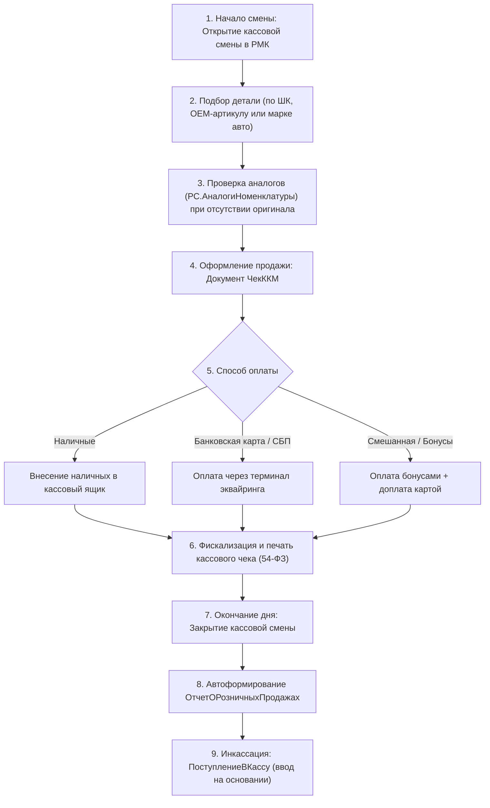
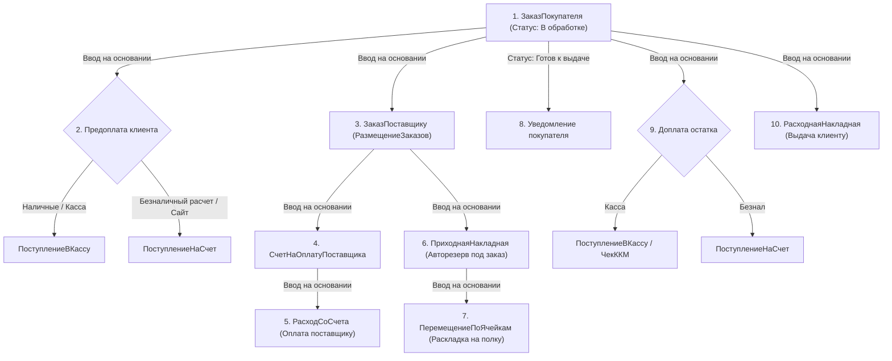
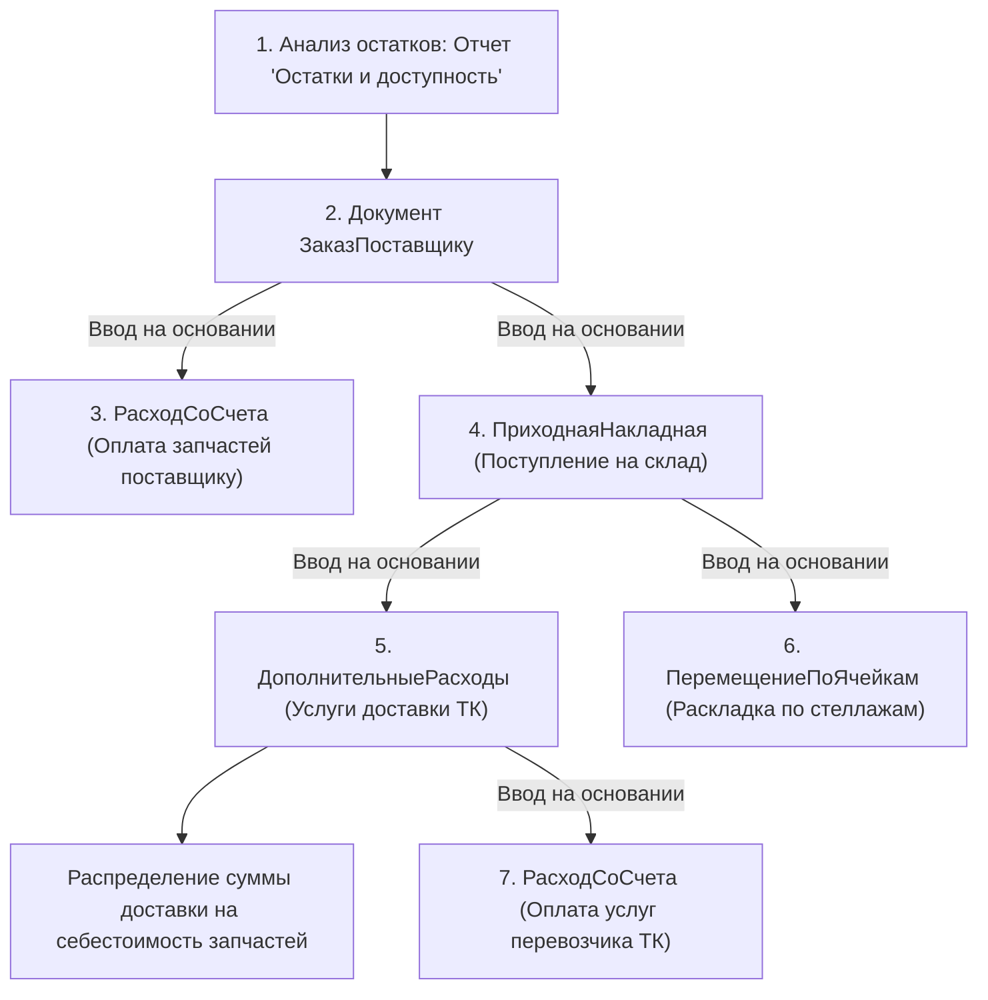
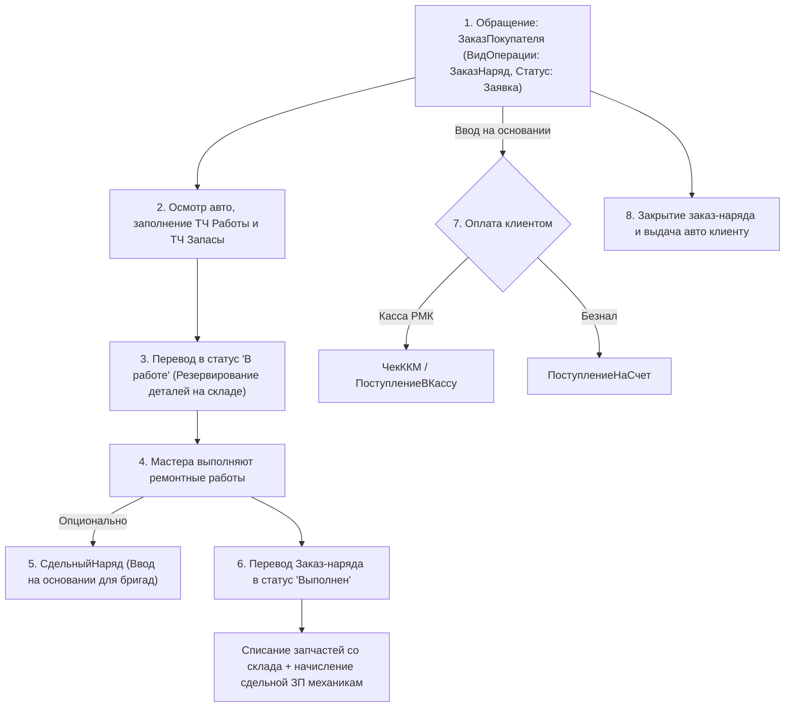
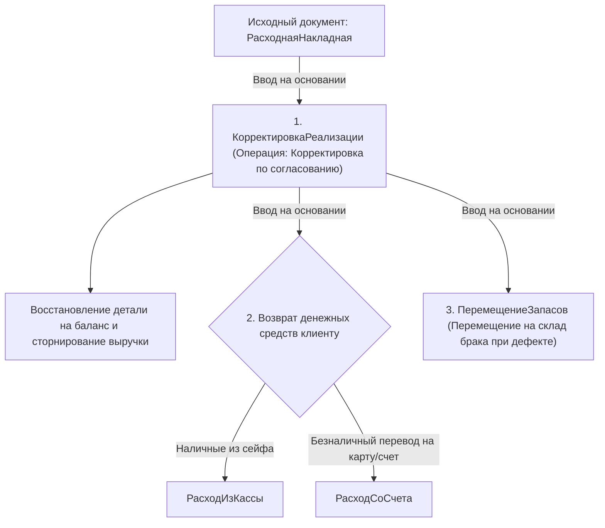
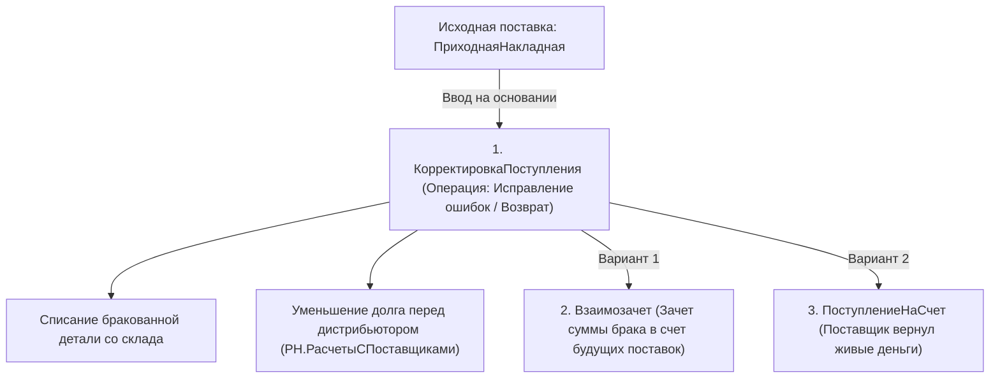
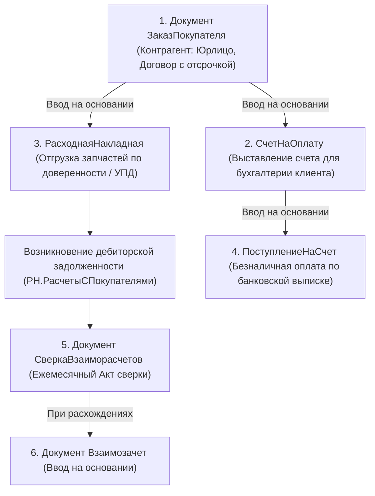

# Бизнес-сценарии использования и цепочки ввода документов (1С:УНФ 3.0)
## Контур: Автоматизация магазина автозапчастей и автосервиса (СТО)

Данный документ описывает регламенты и бизнес-сценарии работы магазина автозапчастей, последовательность действий сотрудников, взаимосвязи документов и правила **ввода на основании** в типовой конфигурации «1С:Управление нашей фирмой 3.0».

---

## Оглавление
1. [Сценарий 1. Розничная продажа «из наличия» в магазине (РМК)](#сценарий-1-розничная-продажа-из-наличия-в-магазине-рмк)
2. [Сценарий 2. Продажа автозапчастей «под заказ» с предоплатой (Ключевой сценарий)](#сценарий-2-продажа-автозапчастей-под-заказ-с-предоплатой-ключевой-сценарий)
3. [Сценарий 3. Регулярная закупка деталей на склад с учетом доставки транспортной компанией](#сценарий-3-регулярная-закупка-деталей-на-склад-с-учетом-доставки-транспортной-компанией)
4. [Сценарий 4. Автосервис и установка запчастей при магазине (Заказ-наряд СТО)](#сценарий-4-автосервис-и-установка-запчастей-при-магазине-заказ-наряд-сто)
5. [Сценарий 5. Возврат товара от розничного или оптового покупателя](#сценарий-5-возврат-товара-от-розничного-или-оптового-покупателя)
6. [Сценарий 6. Возврат бракованной запчасти поставщику (дистрибьютору)](#сценарий-6-возврат-бракованной-запчасти-поставщику-дистрибьютору)
7. [Сценарий 7. Складские операции: инвентаризация, пересорт и ячеистое хранение](#сценарий-7-складские-операции-инвентаризация-пересорт-и-ячеистое-хранение)
8. [Сценарий 8. Оптовые продажи автопаркам и автосервисам (B2B)](#сценарий-8-оптовые-продажи-автопаркам-и-автосервисам-b2b)
9. [Сводная матрица документов и механизма «Ввод на основании»](#сводная-матрица-документов-и-механизма-ввод-на-основании)

---

## Сценарий 1. Розничная продажа «из наличия» в магазине (РМК)

### Описание процесса
Покупатель обращается на кассу розничного магазина автозапчастей за расходными материалами, моторным маслом, автохимией или деталями из складского наличия.

### Роли участников
* **Кассир / Продавец-консультант**
* **Покупатель (физическое лицо)**

### Последовательность шагов и документов



### Детальное описание шагов
1. **Открытие смены**: Кассир запускает рабочее место (`РМК`). Автоматически создается документ `КассоваяСмена` со статусом *«Открыта»*.
2. **Подбор запчастей**:
   - Сканирование штрихкода на упаковке (фильтр, свечи, канистра масла).
   - Поиск по артикулу (OEM-номеру) детали.
   - Если нужного бренда нет в наличии — кассир нажимает кнопку подбора аналогов: система считывает записи из регистра `АналогиНоменклатуры` и показывает дубликаты, имеющиеся на складе.
3. **Регистрация чека**: Формируется документ `ЧекККМ`. Программа проверяет оперативный остаток в регистре `ЗапасыНаСкладах`.
4. **Оплата и фискализация**: Чек пробивается через онлайн-кассу (`КассыККМ`), списывает детали с ячейки торгового зала и увеличивает сумму в `ДенежныеСредстваВКассахККМ` или `ОплатаПлатежнымиКартами`.
5. **Закрытие смены**: В конце рабочего дня кассир выполняет операцию «Закрыть смену (Z-отчет)».
   - Программа автоматически формирует сводный документ `ОтчетОРозничныхПродажах`, в который переносятся все проданные за смену позиции.
   - `ОтчетОРозничныхПродажах` выполняет суммовое списание себестоимости (`РН.Запасы`), начисляет долг банку-эквайеру (`РН.РасчетыПоЭквайрингу`) и фиксирует выручку (`РН.Продажи`).
6. **Инкассация в главную кассу**: На основании документа `ОтчетОРозничныхПродажах` бухгалтер/старший кассир вводит документ `ПоступлениеВКассу` с операцией *«Перемещение из кассы ККМ»*, перемещая наличные из ящика ККМ в центральный сейф магазина.

---

## Сценарий 2. Продажа автозапчастей «под заказ» с предоплатой (Ключевой сценарий)

### Описание процесса
Клиенту требуется деталь, отсутствующая на складе (кузовная деталь, редкий датчик, элемент подвески). Магазин берет предоплату, заказывает позицию у дистрибьютора (Emex, Армтек, Автопитер, Берг и т.п.), принимает на склад, автоматически резервирует под клиента и выдает.

### Роли участников
* **Менеджер по продажам / Подборщик запчастей**
* **Менеджер по закупкам (Снабженец)**
* **Кладовщик**
* **Кассир**

### Последовательность шагов и документов



### Детальная цепочка ввода:
1. **`ЗаказПокупателя` (Первичный ввод)**:
   - Менеджер заносит клиента в справочник `Контрагенты`.
   - В ТЧ `Запасы` указывает артикул, бренд, количество и согласованную розничную цену.
   - Поле `Резерв` оставляется равным `0` (товара нет на складе).
   - Статус заказа: *«В обработке» / «Ожидает предоплаты»*.
2. **Внесение предоплаты (Ввод на основании `ЗаказПокупателя`)**:
   - При наличной оплате: вводится `ПоступлениеВКассу` (вид операции: *От покупателя*).
   - При оплате картой/по счету: вводится `ПоступлениеНаСчет` или фискализируется предоплатный чек в РМК.
   - Заказ переводится в статус *«Оплачен / В работе»*.
3. **Заказ у дистрибьютора (Ввод на основании `ЗаказПокупателя`)**:
   - Снабженец открывает `ЗаказПокупателя` и нажимает **Создать на основании -> ЗаказПоставщику**.
   - В созданном `ЗаказеПоставщику` автоматически заполняется поставщик (Армтек/Берг), номенклатура, количество и связка с клиентским заказом.
   - При проведении формируется запись в регистре `РазмещениеЗаказов` (заказ клиента жестко связывается с поставкой).
4. **Оплата поставщику (Ввод на основании `ЗаказПоставщику`)**:
   - Вводится `СчетНаОплатуПоставщика` (для фиксации в платежном календаре).
   - В день оплаты вводится `РасходСоСчета` (безналичный платеж поставщику по реквизитам).
5. **Приемка детали на склад (Ввод на основании `ЗаказПоставщику`)**:
   - Когда курьер дистрибьютора привозит запчасть, кладовщик нажимает **Создать на основании -> ПриходнаяНакладная**.
   - В строке накладной поле `ЗаказПокупателя` уже заполнено!
   - При проведении `ПриходнаяНакладная`:
     - Физически приходует деталь в `ЗапасыНаСкладах`.
     - В регистре `Запасы` деталь **сразу попадает в резерв** под конкретного покупателя (другой менеджер не сможет ее продать или перехватить).
     - Снимает потребность по регистру `ЗаказыПоставщикам`.
6. **Размещение в ячейку (Ввод на основании `ПриходнаяНакладная`)**:
   - Кладовщик нажимает **Создать на основании -> ПеремещениеПоЯчейкам**.
   - Указывает целевую ячейку выдачи интернет-заказов (например, полка `ЗАК-01`).
7. **Уведомление клиента и смена статуса**:
   - `ЗаказПокупателя` переводится в статус *«Готов к выдаче»*. Клиенту уходит SMS/email или сообщение в мессенджер.
8. **Выдача детали клиенту (Ввод на основании `ЗаказПокупателя`)**:
   - Клиент вносит доплату (формируется `ПоступлениеВКассу` / `ПоступлениеНаСчет`).
   - Менеджер нажимает **Создать на основании -> РасходнаяНакладная**.
   - Документ списывает деталь из резерва склада, фиксирует выручку в регистре `Продажи` и закрывает задолженность клиента.
   - `ЗаказПокупателя` переводится в статус *«Завершен»*.

---

## Сценарий 3. Регулярная закупка деталей на склад с учетом доставки транспортной компанией

### Описание процесса
Пополнение складских остатков ходовых запчастей (масляные/воздушные фильтры, колодки, антифриз, лампочки). Заказ доставляется сторонней транспортной компанией (ТК «Деловые Линии» или «СДЭК»). Стоимость транспортных услуг должна быть включена в себестоимость каждой привезенной запчасти.

### Последовательность шагов и документов



### Детальная цепочка ввода:
1. **`ЗаказПоставщику` (Первичный ввод)**:
   - Формируется заказ на поддержание склада (поле `ЗаказПокупателя` пустое).
2. **Оплата**: На основании вводится `РасходСоСчета`.
3. **`ПриходнаяНакладная` (Ввод на основании `ЗаказПоставщику`)**:
   - Оприходование деталей на центральный склад в зону приемки.
4. **`ДополнительныеРасходы` (Ввод на основании `ПриходнаяНакладная`)**:
   - Кладовщик/бухгалтер открывает накладную и нажимает **Создать на основании -> ДополнительныеРасходы**.
   - В шапке указывается поставщик транспортных услуг (например, ООО «Деловые Линии») и стоимость доставки (например, 4 500 руб.).
   - В табличной части автоматически подтягиваются все позиции из накладной.
   - Выбирается метод распределения: *«Пропорционально сумме»* или *«Пропорционально количеству»*.
   - При проведении документ делает запись в `РН.Запасы` (увеличивает ресурс `Сумма` без изменения количества), распределяя транспортные расходы на себестоимость единицы товара.
5. **`ПеремещениеПоЯчейкам` (Ввод на основании `ПриходнаяНакладная`)**:
   - Раскладка поступившей партии из зоны приемки по постоянным ячейкам адресного склада (стеллажи А-01, А-02).
6. **Оплата перевозчику**: На основании `ДополнительныеРасходы` вводится `РасходСоСчета` для оплаты услуг ТК.

---

## Сценарий 4. Автосервис и установка запчастей при магазине (Заказ-наряд СТО)

### Описание процесса
Клиент приезжает в автотехцентр/СТО при магазине для проведения ТО (замена масла, масляного фильтра, замена тормозных дисков и колодок). Запчасти берутся со склада магазина, а работы выполняют автослесари сервиса.

### Роли участников
* **Мастер-приемщик**
* **Автослесарь / Механик**
* **Клиент**

### Последовательность шагов и документов



### Детальная цепочка ввода:
1. **`ЗаказПокупателя` с видом операции `ЗаказНаряд` (Первичный ввод)**:
   - Мастер-приемщик выбирает контрагента, автомобиль (справочник `ТранспортныеСредства`), вводит пробег и причину обращения.
   - Вкладка **Работы**: подбираются услуги из справочника `Номенклатура` (тип: *Работа*): «Замена моторного масла», «Замена передних тормозных колодок». Указываются нормо-часы и стоимость.
   - Вкладка **Запасы**: подбираются запчасти из магазина (масло 5W-40 4л, масляный фильтр, тормозные колодки).
   - Вкладка **Исполнители**: указываются назначенные слесари (справочник `Сотрудники`) и их КТУ (доля участия).
   - Статус: *«Заявка / Согласование»*.
2. **Перевод в статус «В работе»**:
   - Автоматически резервирует запчасти на складе магазина, чтобы их не продали другому розничному клиенту.
3. **Выполнение работ**:
   - Механики получают детали со склада и устанавливают на автомобиль.
4. **Перевод в статус «Выполнен»**:
   - При проведении наряда в статусе *«Выполнен»*:
     - Списываются запчасти с полок (`РН.ЗапасыНаСкладах`).
     - Списывается себестоимость деталей (`РН.Запасы`).
     - Начисляется сдельная выработка мастерам (`РН.СдельныеНаряды`).
     - Признается выручка за работы и детали (`РН.Продажи`).
     - Формируется задолженность клиента (`РН.РасчетыСПокупателями`).
5. **Оплата (Ввод на основании `ЗаказПокупателя`)**:
   - Через РМК пробивается `ЧекККМ` либо вводится `ПоступлениеВКассу` / `ПоступлениеНаСчет`.
   - Заказ-наряд переводится в статус *«Закрыт»*, распечатывается акт и заказ-наряд с гарантией, автомобиль передается владельцу.

---

## Сценарий 5. Возврат товара от розничного или оптового покупателя

### Описание процесса
Клиент возвращает запчасть (деталь не подошла к автомобилю, ошибочный подбор, клиент отказался от ремонта).

### Вариант А: Возврат розничным покупателем в день покупки (до закрытия смены)
1. **`ЧекККМВозврат` (Ввод на основании `ЧекККМ`)**:
   - Кассир в РМК нажимает кнопку «Возврат», находит исходный `ЧекККМ` по номеру или штрихкоду чека.
   - Нажимает **Создать на основании -> ЧекККМВозврат**.
   - Указываются возвращаемые позиции.
   - Деньги выдаются из кассы ККМ (или отменяется безналичная транзакция через эквайринговый терминал).
   - Деталь возвращается на свободный остаток в `ЗапасыНаСкладах`.

### Вариант Б: Возврат не в день покупки / от оптового покупателя (после закрытия смены)


### Детальные шаги для Варианта Б:
1. Открывается исходная `РасходнаяНакладная` (или `ОтчетОРозничныхПродажах`).
2. Нажимается **Создать на основании -> КорректировкаРеализации**.
3. На вкладке *«Запасы»* уменьшается количество реализованных деталей.
4. При проведении `КорректировкаРеализации`:
   - Деталь приходуется обратно на склад (`РН.ЗапасыНаСкладах`).
   - Восстанавливается себестоимость в `РН.Запасы`.
   - Сторнируется прибыль в `РН.Продажи`.
   - Формируется долг магазина перед клиентом в `РН.РасчетыСПокупателями`.
5. **Выплата денег (Ввод на основании `КорректировкаРеализации`)**:
   - Вводится `РасходИзКассы` (наличные) или `РасходСоСчета` (возврат на банковскую карту клиента). Долг перед клиентом закрывается.

---

## Сценарий 6. Возврат бракованной запчасти поставщику (дистрибьютору)

### Описание процесса
При установке детали выявлен заводской брак (трещина, несоответствие резьбы, течь амортизатора). Оформляется рекламация и возврат дистрибьютору.

### Последовательность шагов и документов



### Детальная цепочка ввода:
1. Находится исходная `ПриходнаяНакладная`, по которой была получена данная партия деталей.
2. Нажимается **Создать на основании -> КорректировкаПоступления**.
3. Указывается возвращаемое бракованное количество.
4. Документ списывает деталь со склада брака (`РН.ЗапасыНаСкладах`), списывает ее себестоимость (`РН.Запасы`) и уменьшает задолженность перед поставщиком (`РН.РасчетыСПоставщиками`).
5. **Урегулирование сальдо**:
   - Если дистрибьютор уменьшает сумму взаимных расчетов: оформляется `Взаимозачет` в счет следующего заказа.
   - Если дистрибьютор возвращает деньги: на основании вводится `ПоступлениеНаСчет`.

---

## Сценарий 7. Складские операции: инвентаризация, пересорт и ячеистое хранение

### Описание процесса
Периодическая ревизия полок и стеллажей магазина автозапчастей. Выявление расхождений между фактическим наличием и учетными данными программы.

### Последовательность шагов и документов

```mermaid
flowchart TD
    A["1. Документ ИнвентаризацияЗапасов (Склад, Ячейка)"] --> B["2. Пересчет и ввод фактического количества деталей"]
    B --> C["3. Автоматический расчет расхождений (Отклонение = Факт - Учет)"]
    C --> D{"4. Анализ расхождений"}
    D -->|Излишки (Отклонение > 0)| E["5. ОприходованиеЗапасов (Ввод на основании Инвентаризации)"]
    D -->|Недостача / Бой (Отклонение < 0)| F["6. СписаниеЗапасов (Ввод на основании Инвентаризации)"]
    E --> G["Постановка найденных деталей на баланс (доход компании)"]
    F --> H["Списание себестоимости утраченных деталей (прочий расход)"]
```

### Детальная цепочка ввода:
1. **`ИнвентаризацияЗапасов` (Первичный ввод)**:
   - Создается документ, выбирается склад и диапазон ячеек (например, стеллаж фильтров `ФИЛЬТР-01`).
   - Нажимается кнопка *«Заполнить по остаткам на складе»*. В табличную часть подтягиваются учетные остатки.
   - Кладовщик со сканером ШК или ТСД сканирует полки и вносит фактическое количество в колонку `КоличествоФакт`.
   - Программа вычисляет колонку `Отклонение`.
   - *Напоминание:* Сам документ `ИнвентаризацияЗапасов` остатки не меняет!
2. **Оприходование излишков (Ввод на основании `ИнвентаризацияЗапасов`)**:
   - Нажимается **Создать на основании -> ОприходованиеЗапасов**.
   - Документ автоматически заполняется только строками с положительным отклонением (излишками).
   - При проведении найденные детали встают на остаток склада и в конкретные ячейки.
3. **Списание недостачи/боя (Ввод на основании `ИнвентаризацияЗапасов`)**:
   - Нажимается **Создать на основании -> СписаниеЗапасов**.
   - Документ автоматически заполняется строками с отрицательным отклонением (недостачами).
   - При проведении себестоимость утраченных деталей списывается на виновных лиц или на расходы предприятия (`РН.ДоходыИРасходы`).

---

## Сценарий 8. Оптовые продажи автопаркам и автосервисам (B2B)

### Описание процесса
Регулярные оптовые поставки автозапчастей корпоративным клиентам (таксопарки, транспортные компании, сторонние СТО) по безналичному расчету с отсрочкой платежа.

### Последовательность шагов и документов



### Детальная цепочка ввода:
1. **`ЗаказПокупателя` (Первичный ввод)**:
   - Выбирается оптовый покупатель, вид цен (например, *«Колонка Опт-2»*). Детали резервируются на складе.
2. **`СчетНаОплату` (Ввод на основании `ЗаказПокупателя`)**:
   - Формируется счет, отправляется по ЭДО или email в бухгалтерию контрагента.
3. **`РасходнаяНакладная` (Ввод на основании `ЗаказПокупателя`)**:
   - По доверенности выполняется отгрузка товара со склада. Распечатывается УПД / ТОРГ-12.
   - Фиксируется увеличение дебиторской задолженности оптовика.
4. **`ПоступлениеНаСчет` (Ввод на основании `СчетНаОплату` или `РасходнаяНакладная`)**:
   - При загрузке банковской выписки («Клиент-банк») оплата привязывается к отгрузочной накладной или счету, закрывая долг клиента.
5. **Контроль взаиморасчетов**:
   - В конце месяца бухгалтер формирует документ `СверкаВзаиморасчетов` (Акт сверки).
   - Если у сторон есть встречные поставки или взаимные долги, на основании сверки вводится документ `Взаимозачет`.

---

## Сводная матрица документов и механизма «Ввод на основании»

Ниже приведена полная справочная таблица связей документов в конфигурации «1С:УНФ 3.0» для автобизнеса:

| Исходный документ (Основание) | Документы, которые вводятся на его основании | Назначение операции в автобизнесе |
| :--- | :--- | :--- |
| **`ЗаказПокупателя`** | `ЗаказПоставщику` | Заказ недостающих деталей у дистрибьютора (связка в `РазмещениеЗаказов`) |
| | `СчетНаОплату` | Выставление счета оптовому клиенту / автопарку |
| | `РасходнаяНакладная` | Фактическая отгрузка / выдача заказанных автозапчастей клиенту |
| | `ПоступлениеВКассу` | Прием наличной предоплаты или доплаты за запчасти / заказ-наряд |
| | `ПоступлениеНаСчет` | Прием безналичной оплаты от покупателя |
| | `СдельныйНаряд` | Распределение сдельной оплаты механикам СТО по заказ-наряду |
| | `ПеремещениеЗапасов` | Перемещение деталей под заказ клиента со склада в пункт выдачи |
| | `КорректировкаРеализации` | Изменение условий или возврат заказа |
| **`ЗаказПоставщику`** | `ПриходнаяНакладная` | Оприходование деталей от поставщика (с авторезервом под покупателя) |
| | `СчетНаОплатуПоставщика` | Фиксация счета дистрибьютора в платежном календаре |
| | `РасходСоСчета` | Безналичная оплата счета поставщика запчастей |
| | `РасходИзКассы` | Оплата поставщику наличными деньгами |
| **`ПриходнаяНакладная`** | `ДополнительныеРасходы` | Включение стоимости доставки ТК в себестоимость привезенных деталей |
| | `ПеремещениеПоЯчейкам` | Раскладка принятой партии запчастей из зоны приемки по полкам/ячейкам |
| | `ПеремещениеЗапасов` | Межскладское перемещение поступившей партии |
| | `КорректировкаПоступления` | Возврат бракованных запчастей поставщику или исправление недовоза |
| | `РасходСоСчета` | Оплата накладной поставщика по факту получения товара |
| **`РасходнаяНакладная`** | `КорректировкаРеализации` | Возврат запчасти покупателем (не подошла, брак, отказ) |
| | `ПоступлениеНаСчет` | Оплата отгруженных запчастей безналичным расчетом |
| | `ПоступлениеВКассу` | Оплата отгруженных деталей наличными деньгами |
| | `СчетНаОплату` | Довыставление счета по факту отгрузки |
| **`ЧекККМ`** | `ЧекККМВозврат` | Возврат запчасти покупателем в кассе РМК день-в-день |
| **`ОтчетОРозничныхПродажах`** | `ПоступлениеВКассу` | Инкассация дневной выручки из операционной кассы РМК в сейф |
| **`ИнвентаризацияЗапасов`** | `ОприходованиеЗапасов` | Оприходование излишков запчастей, выявленных при ревизии полок |
| | `СписаниеЗапасов` | Списание недостачи, боя или утери запчастей |
| **`СверкаВзаиморасчетов`** | `Взаимозачет` | Зачет взаимных требований или перенос долга между договорами |
| **`ДополнительныеРасходы`** | `РасходСоСчета` | Оплата транспортных услуг перевозчику (ТК «СДЭК», «Деловые Линии») |
| | `РасходИзКассы` | Оплата курьеру/водителю доставки наличными |

---

## Контрольные правила для разработчиков при реализации бизнес-процессов

1. **Автоматическое заполнение реквизитов при вводе на основании**:
   - При вводе `ЗаказПоставщику` на основании `ЗаказПокупателя` обязательно копировать `Номенклатура`, `Характеристика`, `Количество` и в строке заказа поставщику указывать ссылку на `ЗаказПокупателя`. Это гарантирует авто-связку в регистре `РазмещениеЗаказов`.
   - При вводе `ПриходнаяНакладная` на основании `ЗаказПоставщику` строковое поле `ЗаказПокупателя` должно наследоваться, чтобы при оприходовании в регистре `Запасы` товар сразу вставал в резерв под клиента.
2. **Запрет двойного ввода**:
   - В формах документов рекомендуется контролировать структуру подчиненности (`КритерийОтбора.СвязанныеДокументы`), чтобы предотвратить повторный ввод двух приходных накладных на один и тот же заказ поставщику сверх заказанного количества.
3. **Отказ от регистров бухгалтерии**:
   - Вся оперативная отчетность и контроль движения товаров, оплат и задолженностей строится исключительно на регистрах накопления (`ЗапасыНаСкладах`, `Запасы`, `РасчетыСПокупателями`, `РасчетыСПоставщиками`, `ДенежныеСредства`).
