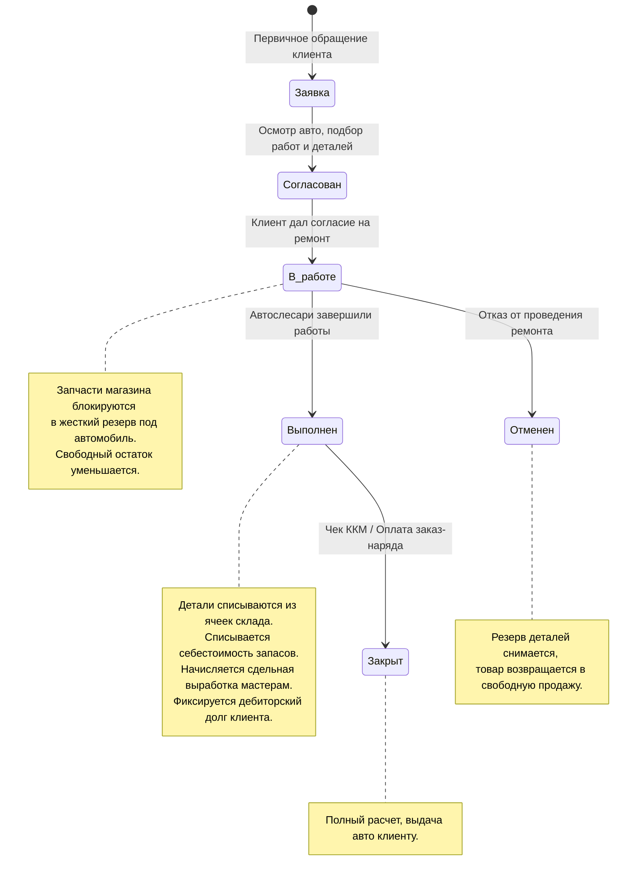

# Функциональное техническое задание на разработку бизнес-системы
## Контур: «Автоматизация магазина автозапчастей и автосервиса (СТО)»
### Архитектурная модель: Объектно-регистровая парадигма (Enterprise ERP)

---

## 1. Назначение и цели документа

Настоящее техническое задание (ТЗ) определяет функциональные требования, бизнес-логику, правила обработки данных и поведение системы автоматизации магазина автозапчастей и сервисной зоны (СТО).

Документ описывает **ЧТО** должна делать система, какие бизнес-правила и ограничения обязаны соблюдаться, не навязывая конкретный стек технологий. Выбор технологий (язык программирования, СУБД, веб-фреймворки, структура таблиц, форматы API) остается в зоне ответственности разработчика.

Документ дополняет проектные материалы:
* [Требования_к_объектам_метаданных_Автозапчасти.md](Требования_к_объектам_метаданных_Автозапчасти.md) — реестр сущностей системы.
* [Описание_реквизитов_объектов_метаданных.md](Описание_реквизитов_объектов_метаданных.md) — состав полей и типов данных.
* [Движения_документов_по_регистрам.md](Движения_документов_по_регистрам.md) — правила изменения учетных регистров.
* [Бизнес_сценарии_и_цепочки_документов.md](Бизнес_сценарии_и_цепочки_документов.md) — регламенты сквозных бизнес-процессов.

---

## 2. Глоссарий и концептуальная модель сущностей

Система базируется на объектно-регистровой модели учета. Для однозначного понимания задач определены следующие базовые концепции:

| Понятие | Роль в бизнес-системе | Назначение и поведение |
| :--- | :--- | :--- |
| **Справочник (Master Data)** | Постоянные объекты предметной области | Хранение условно-постоянной информации (Товары, Склады, Ячейки, Контрагенты, Автомобили, Сотрудники). Поддерживает древовидную иерархию (папки/группы) и подчиненность владельцу. |
| **Документ (Transaction)** | Факт хозяйственной деятельности | Фиксация событий во времени (Заказ, Поступление, Продажа, Чек, Заказ-наряд). Содержит реквизиты шапки и табличные части строк. Имеет статусную модель и операцию проведения. |
| **Регистр сведений (Lookup / State)** | Параметрические срезы данных | Хранение текущих или периодических состояний без математического суммирования (Цены, Штрихкоды, Таблица аналогов/кроссов, Статусы заказов). |
| **Регистр накопления: Остатки (Balance Ledger)** | Учет материальных и денежных остатков | Хранение балансов с фиксацией направления: `Приход` (+) или `Расход` (-). Обеспечивает получение точного остатка на любой момент времени и контроль нехватки. |
| **Регистр накопления: Обороты (Turnover Ledger)** | Накопление объемов за период | Хранение фактов совершения операций (Выручка, Объем закупок, Начисленная выработка мастеров) без вычисления входящего/исходящего сальдо. |
| **Проведение документа (Posting)** | Неделимое отражение в учете | Фиксация документа в учетных регистрах. Обязана быть атомарной операцией: валидация остатков $\rightarrow$ создание учетных записей $\rightarrow$ смена статуса на «Проведен». |
| **Ввод на основании (Based On)** | Наследование и фабрика документов | Механизм быстрого создания дочернего документа по данным родительского с сохранением сквозной связи в истории (структуре подчиненности). |

---

## 3. Бизнес-требования к проведению документов и учету остатков

### 3.1. Двухконтурный учет складских запасов
В автобизнесе учет запасов разделяется на два независимых контура:
1. **Физический складской учет (Количественный)**:
   * Задача: точно знать, на каком складе, в какой конкретно **ячейке** (стеллаж/полка), в каком количестве и с какой серией/партией лежит деталь.
   * Не содержит финансовых сумм.
2. **Финансово-балансовый учет (Стоимостной и резервы)**:
   * Задача: учитывать суммовую себестоимость запасов организации по партиям (FIFO или средняя стоимость) и вести учет **резервов под клиентские заказы**.
   * Не привязан к конкретной полке/ячейке склада.

### 3.2. Контроль отрицательных остатков и формула доступности
При любой операции отгрузки или списания (продажа, заказ-наряд, перемещение, инвентаризационное списание) система **обязана запрещать проведение**, если свободный остаток недостаточен.

#### Бизнес-формула свободного остатка:
$$\text{Свободный остаток} = \text{Фактический остаток на складе} - \sum \text{Резервы под чужие заказы}$$

#### Требования к валидации:
1. Если деталь списывается по конкретному заказу покупателя — резерв, зафиксированный именно за этим заказом, считается доступным для него.
2. Не допускается появление отрицательных количественных и суммовых остатков ни при каких обстоятельствах.
3. При нехватке проведение прерывается с информативным сообщением пользователю:
   * *«Недостаточно товара [Артикул / Бренд / Наименование] на складе [Склад], ячейка [Ячейка]. В наличии: X, в резерве: Y, доступно: Z, требуется: N»*.
4. Проведение должно быть защищено от конфликтов при одновременной работе нескольких пользователей (блокировка проверяемых ресурсов на момент расчета).

---

## 4. Модуль подбора автозапчастей и аналогов (Search & Cross Engine)

Поиск деталей в автобизнесе имеет строгую специфику: покупатели и поставщики используют разные форматы написания одних и тех же номеров деталей.

### 4.1. Нормализация артикулов (Clean Article)
Любой артикул детали при сохранении в карточку номенклатуры и при вводе в строку поиска обязан автоматически очищаться от форматирования.

#### Бизнес-правило нормализации:
* Удаляются все пробелы, дефисы, точки, слэши, подчеркивания и спецсимволы.
* Все латинские и кириллические символы приводятся к верхнему регистру.
* *Результат:* `W-712/75`, `w 712 75`, `W712-75` и `w712/75.` должны распознаваться как единый артикул `W71275`.

### 4.2. Бизнес-логика связей аналогов (Кроссов)
Система должна поддерживать базу взаимозаменяемости автозапчастей со следующими свойствами:
1. **Двусторонняя заменяемость**: если деталь **B** указана как полноценный аналог детали **A**, то при поиске детали **B** система обязана предлагать деталь **A**.
2. **Транзитивность (Цепочки аналогов)**: если **A** заменяется на **B**, а **B** заменяется на **C**, то при поиске детали **A** система должна уметь находить деталь **C** (на глубину не менее 2 шагов).
3. **Классификация аналогов**:
   * *Оригинал (OEM)* — оригинальная деталь автопроизводителя.
   * *Прямой дубликат (Premium)* — качественный аналог от конвейерного поставщика (Bosch, Mahle, Lemforder).
   * *Бюджетный аналог (Economy)* — доступные бренды заменителей.

---

## 5. Требования к интерфейсу АРМ «Подбор автозапчастей»

Интерфейс подбора — ключевое рабочее место продавца-консультанта и кассира. Экран должен объединять складские остатки, базу аналогов и данные внешних поставщиков в едином окне.

### 5.1. Функциональная компоновка экрана подбора

```
+---------------------------------------------------------------------------------------------------------+
| [Поле ввода артикула: W71275                        ] [Выбор склада: Все v] [Кнопка: Найти]             |
+---------------------------------------------------------------------------------------------------------+
| 1. ЗАПРОШЕННЫЙ АРТИКУЛ (ТОЧНОЕ СОВПАДЕНИЕ)                                                              |
|    Бренд: MANN-FILTER | Артикул: W 712/75 | Фильтр масляный                                             |
|    Склад: Центральный | Ячейка: B-03-2 | На складе: 14 шт. | Доступно: 12 шт. | Цена: 680 ₽   [В корзину] |
+---------------------------------------------------------------------------------------------------------+
| 2. АНАЛОГИ И КРОССЫ В НАЛИЧИИ НА СКЛАДЕ                                                                 |
|    - FILTRON OP 545/2    | Ячейка: B-03-3 | Доступно: 8 шт. | Цена: 420 ₽ (дешевле на 38%)    [В корзину] |
|    - MAHLE OC 90         | Ячейка: B-02-1 | Доступно: 3 шт. | Цена: 710 ₽                     [В корзину] |
+---------------------------------------------------------------------------------------------------------+
| 3. ПРЕДЛОЖЕНИЯ ПОСТАВЩИКОВ ПОД ЗАКАЗ (ВНЕШНЯЯ ПРОЦЕНКА)                                                 |
|    - MANN W 712/75 (Поставщик Армтек)  | Срок: Завтра 09:00 | На складе поставщика: >50 шт.    [В корзину] |
|      Закупочная цена: 480 ₽ | Расчетная цена продажи: 650 ₽                                            |
|    - KNECHT OC90   (Поставщик Берг)    | Срок: Сегодня 18:00| На складе поставщика: 12 шт.     [В корзину] |
|      Закупочная цена: 510 ₽ | Расчетная цена продажи: 690 ₽                                            |
+---------------------------------------------------------------------------------------------------------+
| ТЕКУЩАЯ КОРЗИНА: Клиент: Сидоров В.П. | Выбрано: 2 поз. на 1 100 ₽          [Оформить Заказ / Чек]      |
+---------------------------------------------------------------------------------------------------------+
```

### 5.2. Требования к сценарию работы экрана:
1. Менеджер вводит артикул детали (в любом регистре и с любыми знаками).
2. Система мгновенно отображает:
   * Наличие точного артикула на складах компании с указанием точной ячейки хранения.
   * Наличие всех зарегистрированных аналогов на складах компании.
   * Варианты поставки под заказ от дистрибьюторов со сроками привоза и рассчитанной ценой продажи.
3. По нажатию кнопки выбранная позиция переносится в создаваемый документ (`ЗаказПокупателя` или `ЧекККМ`). Если деталь выбрана из внешнего предложения поставщика — система автоматически подготавливает цепочку заказа дистрибьютору.

---

## 6. Бизнес-логика динамического ценообразования (Pricing Engine)

Цены на автозапчасти подвержены частым изменениям у дистрибьюторов. Система должна поддерживать автоматическое формирование отпускных цен на основе матрицы наценок.

### 6.1. Ступенчатая матрица наценок
Розничная цена рассчитывается от входящей базовой себестоимости по правилу ступенчатых диапазонов: чем дороже деталь, тем ниже процент торговой наценки.

#### Базовая шкала наценок:
| Диапазон закупочной себестоимости | Торговая наценка | Правило округления цены продажи |
| :--- | :---: | :--- |
| **от 0.01 до 500.00 ₽** | **+50%** | Округление вверх до 10 ₽ |
| **от 500.01 до 2 000.00 ₽** | **+40%** | Округление вверх до 10 ₽ |
| **от 2 000.01 до 8 000.00 ₽** | **+30%** | Округление вверх до 50 ₽ |
| **от 8 000.01 до 25 000.00 ₽** | **+20%** | Округление вверх до 100 ₽ |
| **свыше 25 000.01 ₽** | **+15%** | Округление вверх до 100 ₽ |

### 6.2. Категории цен для различных клиентских групп:
* **Розничная цена**: формируется строго по базовой матрице наценок.
* **Цена для партнерских СТО**: базовая матрица с дисконтом 12% (поддержка постоянных сервисов).
* **Оптовая цена для автопарков (B2B)**: базовая матрица с дисконтом 18%.

---

## 7. Модуль автосервиса: Жизненный цикл «Заказ-наряда» (Work Order FSM)

Заказ-наряд — составной документ, объединяющий услуги мастеров и материальные детали, списанные со склада.

### 7.1. Диаграмма состояний заказ-наряда



### 7.2. Требования к составу данных заказ-наряда:
1. **Параметры автомобиля**: VIN-номер, госномер, марка, модель, текущий пробег на момент заезда.
2. **Таблица выполненных работ**: список услуг, нормативные нормо-часы, согласованная стоимость часа, итоговая сумма работы.
3. **Таблица материалов и запчастей**:
   * Запчасти компании (списываются со склада магазина с указанием ячейки).
   * Запчасти клиента (давальческие материалы — учитываются в акте без списания с баланса склада).
4. **Таблица исполнителей**: указание автослесарей/механиков с коэффициентом трудового участия (КТУ) для начисления сдельной оплаты от выполненных работ.

---

## 8. Ролевая модель и безопасность данных (RBAC)

Система обязана обеспечивать строгое разделение прав доступа:

| Роль сотрудника | Доступный функционал | Права и ограничения доступа |
| :--- | :--- | :--- |
| **Кассир торгового зала** | Рабочее место кассира (РМК), пробитие чеков, возвраты день-в-день, закрытие смены. | **Запрещено:** просмотр закупочных цен, входящей себестоимости деталей, наценки, данных поставщиков и финансовой отчетности компании. |
| **Менеджер по подбору** | Окно подбора запчастей, оформление заказов покупателей, бронирование, выставление счетов. | Доступ к розничным и партнерским ценам. **Запрещено:** редактирование закупочных цен поставщиков, удаление проведенных документов. |
| **Снабженец / Закупщик** | Заказы поставщикам, приходные накладные, работа с прайс-листами дистрибьюторов. | Полный доступ к ценам закупки, условиям дистрибьюторов и себестоимости. Нет доступа к кассовым операциям и зарплате. |
| **Мастер-приемщик СТО** | Журнал заказ-нарядов, справочник автомобилей клиентов, распределение работ по постам. | Доступ к прайсу сервисных работ и розничным ценам запчастей. Нет доступа к общему финансовому балансу компании. |
| **Кладовщик** | Размещение по ячейкам, межскладские перемещения, проведение инвентаризации полок. | Доступ только к **количественному** учету деталей. Суммовая себестоимость и цены скрыты. |
| **Руководитель / Директор** | Все разделы системы без ограничений. | Полные административные права, управление матрицами наценок, анализ валовой прибыли и рентабельности. |

---

## 9. Функциональные сервисные требования к операциям системы

Система должна предоставлять прикладные сервисные функции для выполнения следующих бизнес-операций:

1. **Сервис управления продажами и заказами**:
   * Создание и расчет итоговой суммы заказа клиента с учетом скидок и программ лояльности.
   * Атомарный перевод заказа в статус резервирования с проверкой остатков.
   * Отгрузка заказа с автоматическим списанием зарезервированного товара.
2. **Сервис складского адресного учета**:
   * Регистрация первичного поступления детали с фиксацией ячейки зоны приемки.
   * Перемещение партии деталей между ячейками хранения без изменения суммового баланса склада.
   * Формирование ведомости инвентаризации с фиксацией расхождений («Учет» против «Факт»).
3. **Сервис кассового обслуживания (РМК)**:
   * Фискализация розничного чека с разделением типов оплаты (наличные, безналичные через эквайринг, оплата баллами лояльности).
   * Оформление возврата товара с восстановлением остатка на складе.
   * Формирование сводного отчета за смену при закрытии кассы.
4. **Сервис сквозной генерации («Ввод на основании»)**:
   * Наследование данных: автоматическое создание `ЗаказаПоставщику` из `ЗаказаПокупателя` с сохранением жесткой привязки потребности.
   * Автоматическая постановка в резерв детали при проведении `ПриходнойНакладной`, созданной на основании клиентского заказа.
5. **Сервис импорта прайс-листов поставщиков**:
   * Пакетный разбор файлов прайс-листов дистрибьюторов (артикул, производитель, остаток, цена закупки, срок доставки) с автоматической нормализацией артикулов.

---

## 10. Критерии приемки системы (Definition of Done)

Решение считается успешно реализованным, если выполнены следующие бизнес-критерии:

1. **Целостность товарных остатков**:
   * Невозможно провести расходную операцию, если свободный остаток детали меньше запрашиваемого количества.
   * Оприходование деталей под заказ клиента автоматически резервирует их под данный заказ и блокирует от продажи другим клиентам.
2. **Корректность поиска и кроссирования**:
   * Поиск по нормализованному артикулу безошибочно находит как точный номер детали, так и всю цепочку зарегистрированных аналогов.
3. **Корректность Заказ-нарядов**:
   * При закрытии заказ-наряда со склада автоматически списываются только детали магазина, а услуги формируют выработку назначенных мастеров.
4. **Соблюдение безопасности**:
   * Кассир и кладовщик ни в интерфейсе, ни в передаваемых данных не имеют доступа к закупочным ценам, себестоимости и марже.
