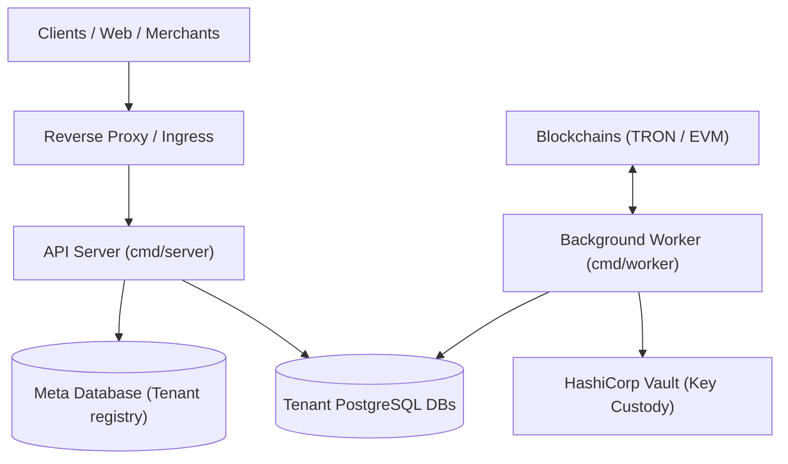
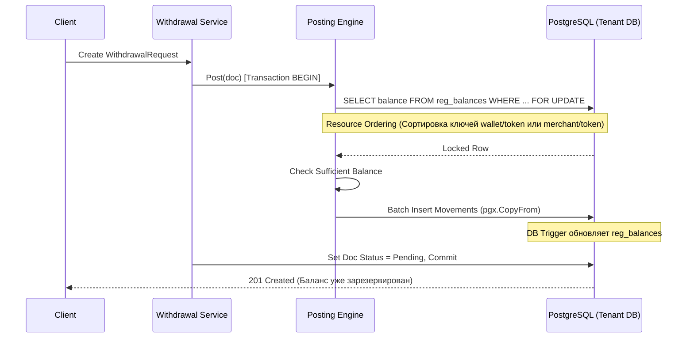

Защита своего проекта на System Design секции — **сильнейшая стратегия**, потому что вы знаете систему изнутри: её трейдоффы, подводные камни и детали реализации.

Интервьюер не знает Metapus, поэтому описывайте реализованные механизмы и отдельно называйте ещё не пройденные production gates. [Mainnet go/no-go](../operations/crypto-mainnet-go-no-go.md) по умолчанию остаётся NO-GO.

Ниже — детальное руководство по защите: от 3-минутного питча до глубоких технических вопросов по Go, базам данных, конкурентности и распределенным транзакциям.

---

# 1. Презентация системы: 3-минутный Pitch (Top-Down)

Когда вам говорят: *«Расскажи об архитектуре своего проекта»*, не начинайте со строчек кода. Используйте фреймворк **Проблема → Решение → Компоненты → Стек**:

> **«Metapus — это мультитенантная ERP и финтех-платформа с криптовалютным процессингом**, написанная на Go 1.27 и PostgreSQL.
>
> Архитектурно система решает две ключевые задачи:
> 1. **ERP-ядро**: учет мастер-данных, регистры накоплений и движок проведения документов (Posting Engine) с жесткими требованиями к финансовой консистентности.
> 2. **Криптовалютный процессинг**: прием и выплата средств в блокчейнах (TRON, EVM), мониторинг сети, FSM инвойсов, sweep-консолидация и подписание транзакций через HashiCorp Vault.
>
> **Компонентная схема:**
> - **API Server (`cmd/server`)**: HTTP-сервис на Gin с серверными auth sessions и локальными кешами. Обслуживает Merchant API, админ-панель и Checkout.
> - **Background Worker (`cmd/worker`)**: фоновый демон. Запускает ingestion-пайплайны (блокчейн-вотчеры), машины состояний (FSM), свипы, сверки и обработку очередей.
> - **Хранилище**: Двухуровневый PostgreSQL с паттерном **Database-per-Tenant** (Meta-DB для маршрутизации и отдельные физические БД на каждого клиента).
> - **Security/Custody**: HashiCorp Vault (family custody plugins + Transit control signing / AppRole) для изоляции приватных ключей — приложение никогда не хранит seed-фразы в БД или памяти сервиса».



---

# 2. Архитектурные блоки: что будут копать на интервью

---

## Блок 1. Мультитенантность: Database-per-Tenant и Connection Pooling

### Вопрос интервьюера:
> *«Почему Database-per-Tenant, а не обычный `tenant_id` в таблицах (Shared Database) или Schema-per-Tenant? И как вы не убили PostgreSQL пулом соединений при 1 000 тенантах?»*

### Как правильно ответить:
1. **Обоснование выбора (Trade-offs):**
   - **Shared DB (`tenant_id`)**: высокий риск утечки данных (достаточно одного забытого `WHERE tenant_id = ...` в сложной аналитике), проблема "noisy neighbor", сложность бэкапа и GDPR/соответствия требованиям отдельного клиента.
   - **Schema-per-Tenant**: при росте до тысяч схем PostgreSQL страдает от раздувания системного каталога (`pg_class`), деградации автовакуума и замедления миграций.
   - **Database-per-Tenant**: идеальная физическая изоляция, независимый backup/restore клиента, возможность шардинга тяжелого клиента на отдельный сервер без переписывания кода.
2. **Как решена проблема соединений (Connection Starvation):**
   - В Metapus пул соединений не создается статически под каждую базу на старте.
   - Реализован **`tenantdb.Manager` с динамическим пулингом**:
     - **Fast-path (кэш)**: `sync.Map` в оперативной памяти хранит активные `pgxpool.Pool`.
     - **Slow-path (инициализация)**: если пула нет, запрос идет в Meta-DB, проверяется статус (`active`), создается изолированный пул с небольшим `max_conns` (например, 5–10 коннектов на тенант).
     - **Eviction Loop**: фоновая горутина каждые 15 минут закрывает пулы баз, к которым не было обращений (Idle Timeout).
     - **Health Check**: периодический пинг активных пулов.
3. **Как это выглядит в Go-коде (Clean Architecture):**
   - Домен и репозитории **не знают** про `tenant_id`.
   - Middleware достает `X-Tenant-ID`, проверяет его совпадение с claim `tid` в JWT-токене, берет пул из менеджера и инжектирует абстрактный `tx.Manager` в `context.Context`.
   - Репозитории вызывают `txManager.GetQuerier(ctx)`, получая соединение/транзакцию текущего тенанта.

---

## Блок 2. Финансовая консистентность: Posting Engine, Блокировки и Double-Spend

### Вопрос интервьюера:
> *«Как вы предотвращаете состояние гонки (Race Condition) и двойные списания баланса (Double-Spending) при высокой конкурентности? Как защищаетесь от дедлоков?»*

### Как правильно ответить:



1. **Два уровня блокировок (Optimistic vs Pessimistic):**
   - **Optimistic Locking (версионирование)**: стратегия по умолчанию для обычных документов и каталогов. Поле `version`, SQL: `UPDATE ... version = version + 1 WHERE id = $1 AND version = $2`. При несовпадении строк — `409 Conflict`.
   - **Pessimistic Locking (`SELECT FOR UPDATE`)**: используется для остатков и сериализации workflow-переходов; дополнительно применяются advisory locks.
2. **Защита от дедлоков (Resource Ordering):**
   - Если транзакция 1 блокирует ресурсы [A, B], а транзакция 2 блокирует [B, A] — возникнет классический PostgreSQL Deadlock.
   - В Posting Engine внедрен инвариант: **все идентификаторы блокируемых ресурсов перед `SELECT FOR UPDATE` сортируются в детерминированном порядке (по алфавиту/ID)**. Это снижает риск AB-BA; другие блокировки и SQL-переходы всё равно требуют согласованного порядка.
3. **Паттерн Debit-First Posting:**
   - Стандартный подход «списывать баланс при подтверждении заявки на вывод» уязвим к гонкам (можно отправить 10 параллельных запросов на вывод $100 при балансе $100).
   - В Metapus вывод использует **Debit-First**: баланс списывается/резервируется **в момент создания документа** (в статусе `Pending`) под `FOR UPDATE`.
   - Если заявка отклоняется администратором или фейлится — создается **компенсирующее сторно-движение** (Audit Trail сохраняется), либо откат движений при unpost.
4. **Неизменяемый регистр (Immutable Ledger) и Visitor Pattern:**
   - Документ не обновляет регистры напрямую. Он реализует интерфейс `MovementSource`.
   - Posting Engine через **Visitor** собирает движения (`MovementSet`), вставляет их пачкой через высокопроизводительный **`pgx.CopyFrom`**.
   - Таблицы агрегированных остатков пересчитываются **триггерами базы данных** на INSERT crypto movements. Ручных `UPDATE balance = balance - 100` в кодовой базе нет.

---

## Блок 3. Фоновые воркеры, Блокчейн-инжестия и Идемпотентность

### Вопрос интервьюера:
> *«Внешние сети (блокчейны, сторонние API) нестабильны: бывают таймауты, реорганизации цепей (reorg), дубликаты событий. Как устроена отказоустойчивость воркера?»*

### Как правильно ответить:
1. **Идемпотентность при at-least-once доставке:**
   - Любое внешнее событие (транзакция, webhook) имеет составной ключ идемпотентности: `hash + log_index` (или `external_id`).
   - В базе создается уникальный индекс в таблице входящих событий. Дубликаты отсекаются на уровне БД без побочных эффектов.
   - Машины состояний (FSM) инвойсов имеют отдельные lifecycle: payment `detected/confirming/confirmed/settled`, invoice `created/paid/confirmed/completed`, а также reorg/reversal и terminal guards. Нельзя перескочить или повторно применить терминальный статус.
2. **Chain Reorganizations (Reorg) и Confirmations:**
   - Платеж не считается зачисленным сразу. Воркер отслеживает количество подтверждений (`confirmations_count`).
   - Пока блок не стал финализированным, инвойс находится в промежуточном статусе. Финансовая проводка в регистр происходит только после достижения безопасной глубины блоков.
3. **RPC Failure & Circuit Breakers:**
   - Управление RPC-нодами: fallback-узлы, prefetch блоков с ограничением по батчам, atomic checkpoints в БД (воркер запоминает последний обработанный блок только после успешного коммита транзакции батча).
4. **Безопасность ключей (custody plugins + Transit):**
   - При выводе worker использует tokenless Proxy с auto-auth AppRole. Transit подписывает control authorization; family plugin проверяет policy/intent и подписывает chain transaction.
   - Ни `cmd/server`, ни `cmd/worker` не держат приватные ключи горячих кошельков в своей памяти или конфигурационных файлах.

---

## Блок 4. Специфика Go: Concurrency, Память и Паттерны

### Вопрос интервьюера:
> *«Как в Go организован жизненный цикл горутин, обработка ошибок и работа с БД без утечек ресурсов?»*

### Как правильно ответить:
1. **Предотвращение утечек горутин (Structured Concurrency):**
   - Никаких «голых» `go func()` без владельца и контекста.
   - Любой воркер принимает `ctx context.Context`. В цикле всегда `select` с `case <-ctx.Done(): return`.
   - Тейкеры/тикеры всегда очищаются: `ticker := time.NewTicker(...); defer ticker.Stop()`.
   - Воркер-пулы используют семафоры на каналах (`chan struct{}`) или `golang.org/x/sync/errgroup` для контролируемого параллелизма (например, в пакетном проведении документов).
2. **Транзакции и `pgx` (Почему не GORM?):**
   - GORM скрывает блокировки, генерирует неоптимальные SQL-запросы и создает overhead на рефлексию.
   - В проекте используется связка `pgx/v5` + `squirrel` (SQL query builder).
   - Паттерн `GetQuerier(ctx)`:
     ```go
     type Querier interface {
         Exec(ctx context.Context, sql string, args ...any) (pgconn.CommandTag, error)
         Query(ctx context.Context, sql string, args ...any) (pgx.Rows, error)
         QueryRow(ctx context.Context, sql string, args ...any) pgx.Row
     }
     ```
     Репозиторий берет `Querier` из контекста. Если открыта транзакция — возвращается `pgx.Tx`, если нет — `*pgxpool.Pool`. Код репозитория универсален.
3. **Оптимизация аллокаций (Hot Paths):**
   - При чтении и маппинге слайсов задается capacity hint: `make([]T, 0, len(items))` вместо пустого `var items []T` с постоянными реалокациями в `append`.
   - Числовые конвертации делаются через `strconv.Itoa` / `strconv.FormatInt`, а не тяжелый `fmt.Sprintf` на горячих путях.
4. **Управление ошибками:**
   - Принцип: *«Ошибку обрабатывай один раз — либо логируй и гаси, либо оборачивай и возвращай»* (никакого `log.Error(err); return err`).
   - Domain возвращает типизированный `apperror.AppError` с code/message/details собственного HTTP-контракта.
   - Gin Handlers тонкие: `c.Error(err); c.Abort()`. Единый Error Middleware маппит ошибку в HTTP-код и JSON, маскируя внутренние ошибки базы (CWE-209 protection).

---

# 3. Топ-10 каверзных вопросов интервьюера и эталонные ответы

| # | Вопрос интервьюера | Ловушка | Эталонный ответ |
|---|-------------------|---------|-----------------|
| 1 | *«Зачем вам Clean Architecture в Go? Разве Go — это не про простые плоские пакеты?»* | Проверка на догматизм. | «Для простого CRUD Clean Architecture избыточна. Но в ERP и финтехе у нас сложная предметная область. Разделение на `core` → `domain` → `infrastructure` позволяет держать доменную модель и валидацию **чистыми функциями без обращений к БД и без зависимостей от HTTP-фреймворка**. Это делает финансовую логику легко тестируемой unit-тестами без поднятия Postgres». |
| 2 | *«Что если процесс упадёт после Vault sign до сохранения результата?»* | Граница внешнего side effect и БД. | «Intent, authorization и точный unsigned fingerprint сохранены до вызова. Exact retry возвращает тот же envelope из replay-safe custody plugin; сохранённые signed bytes используются для lookup/rebroadcast. Новый nonce или операция по timeout не создаются автоматически». |
| 3 | *«Почему вы используете PostgreSQL как основную очередь для задач, а не Kafka или RabbitMQ?»* | Попытка подловить на "резюме-драйвен" архитектуре. | «Введение Kafka добавляет сложность в виде распределенной транзакции между базой и брокером (Dual-Write Problem). Храня задачи и аутбокс в PostgreSQL, мы можем **атомарно в одной транзакции** изменить финансовый баланс и положить задачу в очередь (Transactional Outbox). При текущих нагрузках PostgreSQL с `FOR UPDATE SKIP LOCKED` справляется отлично без оверхеда на поддержку Kafka». |
| 4 | *«Как вы делаете graceful shutdown для HTTP-сервера и фоновых воркеров?»* | Проверка знания Go runtime и сигналов ОС. | «Перехватываем `SIGINT/SIGTERM` через `signal.NotifyContext`. Сначала останавливаем прием новых HTTP-запросов (`server.Shutdown(ctx)` с таймаутом). Затем даем сигнал воркерам через контекст. Воркеры ждут завершения текущей порции задач с помощью `sync.WaitGroup`. В конце `tenantdb.Manager` закрывает все открытые пулы `pgxpool.Pool`». |
| 5 | *«Как обновляются tenant-БД?»* | Согласованное обновление релиза. | «Оператор останавливает server/worker, выполняет init-meta и tenant migrate --all одним новым релизом. CLI обрабатывает active/suspended tenants, сообщает ошибки и сохраняет schema_version. Provisioning применяет схему до active. Текущий код требует точного совпадения schema version; по-тенантного смешения версий нет». |
| 6 | *«Как вы сериализуете работу с кошельками, если у них есть nonce (как в EVM)?»* | Специфика блокчейна и конкурентности. | «В EVM параллельные транзакции с одного кошелька заблокируются по nonce. Поэтому для hot-wallet мы используем либо последовательную очередь с локальной блокировкой на уровне кошелька (`SELECT ... FOR UPDATE` по записи кошелька в БД), либо пул из нескольких горячих кошельков, распределяя нагрузку по ним». |
| 7 | *«Почему в Go не стоит передавать `context.Context` внутри структуры, а только первым аргументом функции?»* | Базовые инварианты Go. | «Контекст привязан к жизненному циклу конкретной операции/запроса, а не к экземпляру сущности или структуры сервиса. Хранение контекста в структуре ломает иерархию отмены, ведет к гонкам данных (data races) и препятствует корректному расчету дедлайнов». |
| 8 | *«Как вы мониторите производительность и утечки памяти в Go-сервисе?»* | Observability и профилирование. | «Включаем `net/http/pprof` на защищенном внутреннем порту. Мониторим метрики через Prometheus (количество горутин, задержки GC, аллокации кучи, статистика `pgxpool.Stat` — активные/свободные коннекты). При деградации снимаем `heap profile` и `goroutine dump`». |
| 9 | *«Что если два администратора одновременно редактируют один и тот же документ?»* | Оптимистичные блокировки. | «Срабатывает Optimistic Locking. Документ содержит поле `Version`. Второй запрос придет со старой версией, условие `WHERE id = $1 AND version = $2` обновит 0 строк, сервис вернет `409 Conflict`, а фронтенд предложит пользователю обновить данные». |
| 10 | *«Как вы форматируете и логируете ошибки, чтобы не нарушать безопасность?»* | OWASP / CWE-209. | «Внутренние технические ошибки (SQL-синтаксис, структура таблиц) оборачиваются через `%w` и пишутся в защищенный лог сервера с трассировкой. Клиенту в HTTP-ответе отдается только обезличенный код ошибки собственного JSON-контракта и безопасное бизнес-сообщение без утечки деталей инфраструктуры». |

---

# 4. Шпаргалка: Как вести саму секцию (Тактика)

1. **Не ждите, пока вас спросят обо всем — ведите диалог.**
   - Когда вам задали вопрос, дайте краткий верхнеуровневый ответ (30 секунд), а затем предложите: *«Я могу подробнее углубиться в то, как мы решали это на уровне PostgreSQL блокировок, или рассказать про организацию воркеров в Go. Что интереснее?»*
2. **Всегда говорите на языке компромиссов (Trade-offs).**
   - Синьор отличается от джуниора тем, что джуниор говорит: *«Мы взяли X, потому что это круто»*, а синьор: *«Мы выбрали X вместо Y, потому что у нас было требование А, хотя мы пожертвовали Б»*.
3. **Держите баланс между Architecture и Go-runtime.**
   - Так как позиция — **Golang разработчик**, интервьюер обязательно захочет услышать:
     - `context.Context` (дедлайны, отмена, propagation),
     - каналы, горутины, мьютексы (`sync.Map`, `sync.RWMutex`),
     - память (эскейп-анализ, слайсы, сборщик мусора),
     - как именно вы используете каналы (для сигналов остановки, а не для перегрузки бизнес-логики).

---

### Команды для самопроверки кода перед собеседованием:
```bash
go build ./... && golangci-lint run ./...
```
