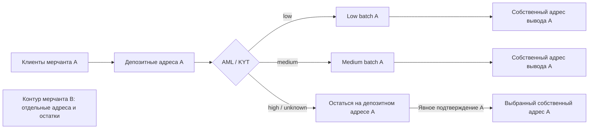

# AML/KYT: изоляция мерчантов и консолидация средств по риску

> **TL;DR:** Каждый мерчант получает собственный контур депозитных, консолидационных и ресурсных кошельков. Сервис оценивает входящие средства и объединяет их внутри этого контура по risk-классам. High-risk средства остаются отдельно; мерчант может явно вывести их на свой адрес. Деньги одного мерчанта никогда не используются для выплат другому.
>
> **Статус:** В коде подключены custody, verified intake, decisions/events, merchant risk balances, token allocations/batches, operating gas, автоматический baseline/activation, class-specific withdrawals и dispatch permits. Для Nile/Sepolia предусмотрен отдельный AML emulator.
> **Объём:** Приём, оценка риска, консолидация и вывод на собственные адреса мерчанта. Правовые процедуры и дальнейшее использование выведенных средств здесь не проектируются.
> **Связанные:** [Архитектура процессинга](crypto-processing-architecture.md), [Сценарии пересмотра риска](aml-kyt-risk-scenarios.md), [Интеграционные аккаунты](../operations/integration-accounts.md).

## Компоненты

Реализованы базовый AML-слой, guards изоляции мерчантов и обработка риска входящих средств. Рабочие сети автоматически не переключаются на новую модель. Во включённом AML scope отправки идут только через зарегистрированные class/source contracts и свежие permits; прежний classless outbound путь закрыт.

- [Домен AML](../../internal/configuration/crypto/domain/crypto/aml/risk.go): точные score bands/freshness, unknown/critical signals, conservative pool class, один risk-класс и один merchant при планировании source lines, net/free/reserved/technical-hold breakdown.
- [Getblock.net adapter](../../internal/configuration/crypto/infrastructure/aml/getblocknet/client.go): отдельные submit/poll, pinned account/ticket/asset/effect binding, точная нормализация и запрет автоматического платного retry. Capability mapping включается только явно; тестовые fixtures синтетические и не подтверждают mainnet coverage.
- [Оркестратор jobs](../../internal/configuration/crypto/application/cryptoapp/aml_job_service.go) и [PostgreSQL repository](../../internal/configuration/crypto/infrastructure/storage/postgres/crypto_repo/aml_jobs.go): persisted request IDs, lease/fencing, restart polling, submission_unknown/needs_attention, immutable reports.
- [Миграция 00008](../../db/configuration/crypto/00008_crypto_aml.sql): неизменяемый custody owner, network/token/merchant FK scopes, subjects/jobs/checks/reports/decisions/risk states/withdrawal snapshots, защита evidence и rollback с данными. Legacy owners автоматически не присваиваются.
- [Getblock.net runtime](../operations/crypto-aml-runtime.md): отдельный профиль/credentials и package quota без monthly reset; immutable принятые mappings, pinned resolver, opt-in worker submit/poll, однократный локальный paid admission с конечным бюджетом. Новый месяц и смена ключей не пополняют бюджет; pending tickets опрашиваются при отключённых submit.
- [Verified intake и проекция риска](../operations/crypto-aml-risk-projection.md), [миграция 00008](../../db/configuration/crypto/00008_crypto_aml.sql): атомарный idempotent enqueue, exact effect/proof binding, immutable policy decisions, явный пустой baseline и покрытие физического inventory по financial basis, консервативный риск wallet/token. Поздний high распространяется по своим внутренним sources/collectors; неизвестные средства не становятся low по совпадению сумм.
- Audited rescreen с expected generation через repository, защита от запоздалого low/неоценённого report, инвалидация при reorg/coverage regression/изменении ledger/policy/mapping, TTL и отдельный `wallet.risk_changed` через merchant event/outbox. Классификация не создаёт повторных financial receipts.
- [Guards изоляции мерчантов](../operations/crypto-merchant-custody.md): owner-aware allocation/collectors/gas funding/source reservation; проверки до подписи и каждого broadcast, включая EVM replacement; независимый immutable registry в обоих Vault plugins, readiness enforcement. Политика custody по умолчанию выключена. Мерчанты используют отдельные fee wallets. Сохранённые signing attempts остаются доступны для recovery.
- [Trusted merchant provisioning](../operations/crypto-aml-batches.md): отдельный control-plane request/lease, pinned HD path, binding владельца в Vault до SQL publication, replay и защита namespace/БД.
- [Автоматические merchant pools](../operations/crypto-aml-merchant-pools.md): конечные scope/network budgets, ready/pending/queued, control-plane consumer, baseline-gated intake и открытие подготовленной партии.
- [Portal баланс по риску](../operations/crypto-aml-risk-balances.md): read-only согласованный snapshot merchant net после комиссии, четыре класса и free/reserved/technicalHold; debit-first claim учитывается один раз. Неоднозначная net/source attribution закрывается консервативно. Опциональная таблица в обзоре, предупреждения при скрытом виде, пользовательская настройка, expiry/error states.
- [Durable inventory allocations](../operations/crypto-aml-inventory-allocations.md): payment net/fee facts, reservation split до подписи, exact posted/verified token sweep application, idempotent replay и audited pre-authorization cancellation. Частичный перенос сохраняет доли, late high меняет риск обоих остатков без нового financial credit.
- [Operating gas budget и native funding](../operations/crypto-aml-resources.md): отдельные native resource positions/facts, verified operating receipt без merchant credit, резерв funding + fee cap до подписи, exact final cost/funding и reverted fee-only accounting. Unknown outcome удерживает резерв; late high запрещает новую подпись.
- [Batch intake/capacity](../operations/crypto-aml-batches.md): immutable token/class collector, лимит gross/age, committed/reserved/unplanned, выбор готовой партии и allocation в одной транзакции; close/hold/audit, late high и guards новой подписи.
- Activation budgets, точные компенсации withdrawal lines и owner/class/batch-aware dispatch permits.
- Risk-class withdrawal API кабинета/approval/signing/dispatch snapshots, sources и класс средств в истории вывода.
- [Testnet AML emulator](../operations/crypto-aml-testnet-emulator.md): случайные воспроизводимые Nile/Sepolia reports без API-ключей и paid calls, отдельный provider и запрет mainnet.
- [Testnet opening inventory](../operations/crypto-aml-testnet-bootstrap.md): однократный low для согласованных старых остатков, без изменения финансового ledger.

## 1. Ответственность сервиса и инварианты

Сервис помогает мерчанту принимать оплату, видеть риск поступлений и выводить собственные средства без непреднамеренного смешивания с более рискованными остатками. Score — оценка поставщика на момент проверки. Классы `low/medium/high` являются правилами маршрутизации, а не обещанием неизменности оценки.

1. **Один principal — один мерчант.** У каждого используемого депозитного и консолидационного адреса есть неизменяемый custody owner. Изоляция database-per-tenant не заменяет изоляцию мерчантов внутри tenant.
2. **Никакой общей merchant liquidity.** Свипы и выплаты выбирают source по tenant + merchant + network + token + risk class + batch. Мерчант B не получает выплату из principal мерчанта A, даже если оба поступления low-risk.
3. **Адрес не переходит другому мерчанту.** Возвращать пустой депозитный адрес можно только в пул его владельца. Retired-адрес сохраняет owner, ключ, watch target и обработку поздних поступлений.
4. **Непроверенное не становится low-risk.** Pending, отсутствующий score, unsupported mapping и ошибка провайдера не разрешают автоматическую консолидацию. Отдельное явное разрешение владельца на вывод без score не переклассифицирует деньги в low.
5. **Более рискованное не понижает класс через смешивание.** Автоматически объединяются только одинаковые risk-классы. Средний/взвешенный score не применяется для разбавления высокого риска.
6. **High — отдельный маршрут.** Автосвип в обычный пул отключён. Мерчант видит поступление и может подтвердить прямой вывод на свой адрес с сохранением risk history.
7. **Повышение риска меняет маршрут, не сумму денег.** Остатки и доступность обычных операций переклассифицируются. Уже существующий merchant balance не удаляется; выполненная выплата не повторяется и не обращается назад изменением score.
8. **Технические gates обязательны для любого вывода.** Проверяются владелец, chain evidence/finality, поддерживаемый контракт, реальная доступная сумма, резервы, fee budget, замороженные реквизиты intent и полномочия подписанта. Подтверждение high-risk не отменяет эти проверки.
9. **Один intent — один outflow.** Idempotency, durable signing attempt, сохранение bytes/txID до broadcast, восстановление неизвестного результата и однократный settlement обязательны.
10. **Signer проверяет merchant boundary.** Принадлежности tenant недостаточно: source и внутренний destination должны принадлежать одному мерчанту в доверенном signer registry. Внешний destination связан с подтверждённым intent этого мерчанта.
11. **Одна заявка на вывод — один риск-класс.** В MVP заявка явно выбирает low/medium/high/unknown и использует principal только этого класса. Недостающая сумма не добирается из другого класса; несколько классов выводятся отдельными заявками.

В MVP: TRON Mainnet / USDT после приёмки реального vendor contract. Ethereum — отдельное включение после проверки adapter/Vault. Объём ограничен приёмом, оценкой, консолидацией и выводом собственных средств мерчанта; возвраты плательщикам, компенсации, DEX и сложная treasury/rebalance система проектируются отдельно при необходимости.

## 2. Контур мерчанта и умная консолидация

### 2.1. Кошельки

`merchant_pool`, `liquidity_hot`, `network_fee`, `treasury` остаются финансовыми ролями. Роль не определяет владельца или risk-класс. Для wallet задаются отдельно:

- неизменяемый `custody_merchant_id` для мерчантского контура;
- `risk_segment = unclassified | low | medium | high`;
- token scope и `batch_id` для консолидационного кошелька;
- status, incoming revision, execution revision и технические holds.

Неизменяемый custody owner хранится отдельно от transient lease и persistent assignment. Для платформенных операционных кошельков owner может отсутствовать, но они не могут быть источниками чужого merchant principal.

Owner закрепляется до первой выдачи адреса/финансирования; кандидат без owner должен быть ранее не использован и проверен preflight. Claim owner атомарен. Общая очередь заранее выведенных, ещё не использованных адресов допустима только до такого закрепления. Исторически использованный адрес не может стать «новым» после обнуления balance.

### 2.2. Правила маршрутизации

Пороги — настраиваемый стартовый пример, а не универсальная шкала доверия. В домене используется целый `ScoreBP` 0..10000; таблица показывает привычную шкалу 0..100. Полнота evidence и критические сигналы проверяются до сравнения порогов.

| Результат | Автоконсолидация | Вывод мерчанту |
|---|---|---|
| 0..30, валидное покрытие, без критических/unknown signals | В low batch того же мерчанта | Обычный вывод по настройкам мерчанта |
| >30..70, валидное покрытие, без критических/unknown signals | В отдельный medium batch того же мерчанта, если включён | Отдельно выбранный medium-остаток; автопорог задаёт мерчант |
| >70 либо критический risk signal | Запрещена в обычные low/medium batches; оставить на origin | Явный `export_high_risk` владельцем на свой адрес |
| Pending, недоступный провайдер, неполный/противоречивый report | Запрещена | Ожидание проверки либо явный `export_unknown` владельцем |
| Unsupported chain/asset/signing path или непроверенный chain effect | Запрещена | Технически не включается до подтверждения capability/evidence |

Критические signal keys получают явное treatment; новый/непонятный ключ не даёт low. Сами vendor signals сохраняются, без попытки вывести из них недокументированную семантику.

Автоматическая консолидация объединяет только один merchant/network/token/risk class/batch. Low → medium допускается лишь как отдельный осознанный downgrade внутри мерчанта; medium/high → low запрещён. Для MVP достаточно low/medium batches; общий high collector не нужен — high выводится прямо с исходных адресов.

Risk-класс общего fungible остатка не лучше наиболее ограничительного unresolved вклада и текущей оценки адреса. Score самого consolidation wallet не усредняется с входящими score и не перекрывает известный высокий риск origin. Для неизвестного вклада действует unclassified до проверки.

### 2.3. Ограничение размера batch

Чтобы поздняя ошибка одного платежа не затронула весь баланс мерчанта, low/medium intake ограничивается суммой и временем. Лимиты задаются отдельно для merchant/network/token/class. После закрытия batch новые свипы направляются в следующий собственный batch.

На старте достаточно intake-open/closed и execution hold; обязательный cooling, многодневная выдержка и отдельный документ ребалансировки не требуются. Перед обычной выплатой выполняется актуальная оценка source. Возраст batch сам по себе не понижает риск.

Capacity резервируется атомарно: `committed + reserved + new_amount <= limit`. Unknown broadcast сохраняет reserve до доказанного исхода. Закрытие intake учитывает уже зарезервированные in-flight свипы. Внешний нежелательный перевод может превысить лимит — система фиксирует факт и закрывает автоматический intake, не скрывает превышение.

Пулы разных мерчантов не объединяются ради экономии комиссий. Для небольшого мерчанта допустим прямой вывод без промежуточного collector, если выполнены те же source/owner/risk gates.

## 3. Приём, состояния и учёт

### 3.1. Chain, деньги и risk — отдельные измерения

| Измерение | Смысл |
|---|---|
| Chain/payment FSM | Detected/confirming/confirmed/settled/reorged сохраняют техническое назначение; finality и verified effect обязательны |
| Risk state | pending/low/medium/high/unknown; report, checked subject, версии, время и причины |
| Merchant financial balance | Сколько средств учтено за мерчантом с учётом тарифов и исполненных/зарезервированных операций |
| Risk inventory / availability | Какие собственные wallet balances доступны для обычного low/medium вывода, отдельного risk export либо ещё ждут проверки |

Подтверждённое canonical поступление учитывается ровно один раз, независимо от risk-класса. Оно принадлежит мерчанту и отображается в его средствах; risk определяет допустимый маршрут, а не факт поступления. Доступность каждого маршрута определяется отдельной проекцией по risk-классам и реальным источникам. Смена score не создаёт новый receipt/fee/merchant credit.

Physical receipt и распределение merchant net/fee имеют отдельные основания. Проверенные неподобранные переводы попадают в невыясненные по правилам [входящего учёта](crypto-inbound-provider-accounting-design.md). Unknown owner остаётся в техническом разборе; его нельзя угадать по текущему lease или отдать новому пользователю адреса.

В UI/API отдельно показываются total, pending risk, low, medium, high, активные withdrawal reservations и фактически выведенное. Это согласованные представления одних денег, а не складываемые дополнительные балансы. Invoice chain confirmations и AML status публикуются отдельно. Сигнал для автоматического исполнения заказа/отгрузки определяется merchant risk policy; сам факт получения high-risk перевода не является обещанием безопасного исполнения заказа.

### 3.2. Остатки, резервы и комиссия

Financial register по merchant/token можно переиспользовать. Для выбора источника нужна проекция net principal и fee/reserved portions по owner + wallet/token + class/batch; общая сумма merchant balance не является разрешением расходовать любой wallet.

Withdrawal фиксирует один класс, конкретные source wallets и суммы; использует только фактически доступный собственный principal выбранного класса после fee/native reservations. Несколько sources одного класса дают явные lines/txs с общим пределом заявки. Вывод high не обслуживается из low-остатка в обмен на оставление high на платформе. Native fee funding учитывается отдельно и не добавляет другой класс principal в заявку.

`WithdrawalRequest` уже работает debit-first: создание уменьшает ledger balance до исполнения выплаты. Новые risk/source reservations связываются с тем же intent и не уменьшают financial balance второй раз. При risk change request переоценивается; при доказанном cancel исходный debit компенсируется один раз. Unknown/signing-in-flight не получает преждевременную компенсацию.

Processing fee сохраняется как отдельная часть движения, недоступная для merchant principal withdrawal. Если fee физически остаётся на адресе, это учитывается в source spendable amount. Её последующий сбор — отдельная операция оплаты услуги с точной суммой и owner/basis; он не разрешает объединять principal мерчантов или оплачивать B остатками A. Риск собранных средств сервиса отслеживается отдельно от merchant principal.

При reorg используются компенсирующие движения по конкретному verified effect. Internal sweep/funding не создаёт второе внешнее поступление/merchant credit на destination. Деньги — `types.RawAmount` / `NUMERIC(78,0)` minor units.

### 3.3. Durable risk jobs и reports

1. Ingestion сохраняет verified observations всех управляемых адресов, включая dust, hot, unmatched и retired. Source owner берётся из постоянного custody binding.
2. Observation, pending subject, incoming/execution revision и job согласуются атомарно до экономического использования. Chain effect: network/tx/event kind/index/block/economics identity, payment optional.
3. Worker делает один submit либо poll вне DB-транзакции, с lease/fencing. Provider ticket и account сохраняются; потерянный ACK восстанавливается без слепого платного submit.
4. Immutable report сохраняется отдельно от решения маршрутизации. Decision содержит action, merchant, subject, source/destination, token/amount, report/policy versions, expiry и wallet revisions.
5. Only current evidence/generation разрешает автоматическое действие. Валидное ещё не рассмотренное high evidence старой generation создаёт risk-change event; ошибочный binding/orphaned subject не применяется к другому актуальному effect.
6. Публикуются idempotent outbox события: received/risk_pending/risk_classified/risk_changed/withdrawal status. Score и raw history не переписываются.

Минимальный adapter contract остаётся асинхронным: `SubmitAddress`, `SubmitTransaction` → ticket, `GetResult(ticket)` → pending/success/failure, `FindReports` → recovery candidates. Request содержит network/contract/token, receiving address и точную chain-effect identity. Ticket содержит provider/account/check hash, заранее сохранённый request ID/digest. Report содержит score/signals/coverage, версии и raw evidence. Наличие HTTP 200 или check hash не означает готовый low-risk report.

### 3.4. Опциональный вид «Баланс по риску»

В кабинете мерчанта сводка показывает общий net principal по выбранным network/token и действие «По риску», раскрывающее компактную таблицу. Настройка сохраняется для пользователя; backend risk routing работает независимо от выбранного вида. Если есть high/неопределённые остатки или недоступные для выбранного вывода средства, сводка показывает сумму и причину даже при скрытой таблице.

| Класс | Всего | Свободно | В заявках на вывод | Действие |
|---|---:|---:|---:|---|
| Низкий | 7 000 | 6 500 | 500 | Обычный вывод |
| Средний | 2 000 | 2 000 | 0 | Вывод medium |
| Высокий | 800 | 800 | 0 | Подтвердить рискованный вывод |
| Не определён | 200 | 200 | 0 | Дождаться оценки / подтвердить unscored export |
| Итого, USDT / TRON | 10 000 | 9 500 | 500 | Выбрать класс средств |

Суммы — иллюстративный пример после processing fee. «Свободно» означает отсутствие резерва/технического удержания, а не готовое разрешение на любой маршрут. Перед выводом выполняются текущие owner/risk/source/fee gates. Pending и unknown могут быть объединены в строку «Не определён», с различимыми причинами в деталях. Отсутствующая оценка не называется низким риском; исторический высокий риск не скрывается только из-за нового pending rescreen. Срок действительности оценки показывается отдельно; устаревший low-report не открывает обычный маршрут.

Для каждого класса `всего = свободно + в заявках + технически недоступно`; последняя колонка показывается, когда есть такие остатки. Состояния взаимоисключающие: potentially executable request остаётся «В заявках», даже если одновременно имеет причину технической остановки. Подтверждённый principal под активным debit-first request включается в «Всего» ровно один раз до final settlement: это остаток merchant ledger плюс ещё не погашенные debit-first заявки, без повторного добавления source reservations. Уже выведенное и ещё не подтверждённые chain receipts показываются отдельно. Нельзя суммировать разные token/network как одни minor units.

Раскрытие строки ведёт к собственным source wallets/batches и поступлениям: сумма, текущий класс, последний score/report time, freshness/status, причина пересмотра и допустимый маршрут. Класс берётся по текущему источнику средств. Если 100 high-risk units затронули общий pool с 9 900 другими units, показывается весь оставшийся net principal этого pool в более ограничительном классе; в деталях видно, какое поступление вызвало изменение. Это не утверждение, что исходные платежи имели одинаковый score.

В форме вывода класс/источники задаются явно. По умолчанию обычный вывод предлагает low; medium включается согласно настройке мерчанта, high/unknown используют отдельное подтверждение. Недостающая сумма из другого класса не добавляется автоматически. Если класс source изменился при открытой форме, сервер возвращает новый snapshot и требует обновить intent/подтверждение; старый UI не определяет разрешённую сумму.

Merchant balance API возвращает totals и breakdown из одного согласованного projection snapshot с revision/as-of и scope network/token. Каждая сумма выводится из тех же owner/source/class/reservation данных, что использует executor. Это представление существующих средств, а не ещё один финансовый ledger. Разбивка по риску и профиль показа опциональны для интерфейса; корректный source gate обязателен для всех API-команд.

**Подключённый этап:** Portal endpoint `/balances/risk` и таблица в обзоре читают точный net snapshot. Payment facts и заранее зарезервированные token sweeps сохраняют net/fee/source identity, включая частичный перенос; receipts до зачисления показываются отдельно. Исторический transfer без плана, native costs без resource budget и debit-first request без точной source allocation не получают предположительного свободного low. Новый outbound executor использует точные source reservations и свежие dispatch permits; старый classless контракт включённого AML scope закрыт. [Контракт read model](../operations/crypto-aml-risk-balances.md), [allocation facts и ограничения](../operations/crypto-aml-inventory-allocations.md).

## 4. Спецификация AML-провайдера Getblock.net

### 4.1. Идентичность провайдеров и credentials

| Назначение | Название в UI | Provider ID | Подключение |
|---|---|---|---|
| Blockchain RPC | Getblock.io | `getblock` | RPC-соединения и слоты `fullnode`/`solidity` |
| AML/KYT | Getblock.net | `getblock_net` | Live AML-провайдер |
| AML testnet | Локальный эмулятор | `testnet_aml` | Только Tron Nile и Ethereum Sepolia; synthetic provenance |

Getblock.io и Getblock.net используют отдельные provider IDs и credentials. Getblock.net относится к `aml_kyt` и использует bearer slot `default`. Подробнее в [реестре интеграций](../operations/integration-accounts.md).

Оба профиля используют существующее шифрование `cat_integration_accounts`, серверный реестр, UI и permission model. Проверка реквизитов выбирается по profile, а не по совпадению бренда. Package balance Getblock.net не получает monthly reset по правилам RPC; добавить соответствующую quota policy и runtime state. Аккаунты/пакеты двух сервисов независимы; секреты не попадают в reports/logs.

### 4.2. Подтверждённые элементы внешнего контракта

Источник: [Getblock.net API](https://getblock.net/en/api/documentation). POST endpoint: `https://api.getblock.net/rpc/v1/request`; JSON-RPC 2.0, bearer token, IP allowlist; `id` — строка до 32 символов.

| Метод | Параметры / результат |
|---|---|
| `checkup.ping` | Проверка доступа |
| `checkup.currencylist` | Справочник `currency/issuer/token_id/unit` |
| `checkup.checkaddr` | `addr, currency[, token_id]` → `result.check.hash` |
| `checkup.checktx` | `tx, addr, currency[, token_id]` → `result.check.hash` |
| `checkup.getresult` | `hash` → `result.check.status/report` |
| `checkup.findreport` | `hash, currency` → `result.checks` |
| `checkup.getcheckshistory` | История; для расследования |

Submit списывает проверку из пакета; getresult/findreport/history не списывают её. Финальный пример имеет status `SUCCESS`, `initDate/resultDate`, `report.riskscore`, словарь `report.signals`; address-report допускает null в суммах. История показывает отдельную шкалу риска 0..100. Метаданные пакета используют имена `cheks_left/cheks_used`. Примеры сигналов: `sanctions`, `dark_market`, `stolen_coins`, `ransom`, `mixer`.

### 4.3. Наша стратегия asset mapping и проверки покрытия

При разработке сначала сохранить и проверить currencylist, затем сформировать версионированный mapping по фактическому network + contract + decimals. `token_id` хранится как provider identifier, а не внутренний TokenID; сравнение ticker недостаточно. Не вызывать currencylist перед каждым submit.

| Контур | Принятая стратегия адаптера |
|---|---|
| TRON Mainnet / USDT | currency `TRX` + token_id из проверенного issuer; первый production gate |
| Ethereum Mainnet / USDT, USDC | currency `ETH` + token_id по issuer; отдельная приёмка |
| Native TRX / ETH | Отдельный mapping native, без подстановки token ticker |
| Nile / Sepolia | Fixtures/stub; vendor sandbox только после подтверждения поддержки |
| Другие assets/контракты | Unsupported → review/hold до приёмки |

Для MVP выбирается единая форма currency + token_id, без смешивания aliases. Числовые token IDs из примеров не зашиваются в код. Каждая binding-ссылка содержит snapshot справочника, issuer и decimals; неподтверждённая смена mapping инвалидирует разрешения.

Для входящего checktx `addr` берётся из верифицированного управляемого получателя. Для исходящей проверки направление и checked address фиксируются явно. Checkaddr также получает token scope; старое предположение о проверке всех assets адреса удаляется.

Проверяется связь ticket → account → первоначальный request → network/asset/tx/addr → chain evidence. Результат по выходному адресу не объявляется точным per-log анализом: если в tx несколько подходящих effects и coverage нельзя обосновать, требуется review. Findreport не используется для угадывания token identity: поиск по базовой валюте может вернуть несколько кандидатов, и недостаток данных запрещает автоматическое присвоение отчёта.

### 4.4. Принятый контракт нормализации и ограничения evidence

Версию локального контракта адаптера задаёт `getblock-net-rpc-v1.<revision>`. До production принимаются реальные обезличенные fixtures для submit, pending, success, failure и ошибок. Синтаксические неточности примеров документации не копируются в parser.

Для `getresult.report.riskscore` адаптер использует шкалу доли 0..1 с обязательным контрактным подтверждением до enablement: decimal ×10000 → ScoreBP. Например, 0.056 → 560 BP → 5.6 по шкале политики 0..100. Разбор выполняется точно как decimal; если нужны доли BP, округлять вверх и сохранять исходное значение, чтобы не понизить риск на границе policy. История с 0..100 не является источником решения. Если реальные fixtures противоречат выбранной шкале, версия контракта пересматривается, production gate остаётся закрытым. Эвристика «<=1 значит доля, иначе проценты» запрещена.

Нормализованные значения signals не считаются модельными весами и не используются для пересчёта общего score. Адаптер сохраняет raw name/value и source path; семантика и диапазоны закрепляются fixtures. Direct/indirect attribution, direction, authorities и dataset as-of остаются unknown, если сервис их не вернул. Нулевой/отсутствующий сигнал не заменяет полную проверку покрытия.

Начальная policy mapping; полная таблица всех принятых ключей проверяется контрактными тестами:

| Provider key / группа | Canonical treatment |
|---|---|
| sanctions | sanctions_exposure; high/review, без автоматического смешивания |
| dark_market / dark_service | darknet |
| stolen_coins | theft |
| ransom | extortion |
| scam / exchange_fraudulent | scam |
| mixer | mixer; ограничение по policy |
| terrorism_financing / child_exploitation | Отдельные critical categories |
| enforcement_action / seized_assets | Отдельный enforcement context, без приравнивания к sanctions |
| exchange_licensed/unlicensed и exchange_mlrisk_* | Сохранить различия license/risk; не схлопывать в clean |
| p2p_exchange_* | P2P с сохранением risk/license context |
| other, новый ключ | unclassified/unknown; по умолчанию review |
| Остальные принятые ключи | Явная запись mapping с policy treatment |

Успешный report требует SUCCESS, совпадения correlation/ticket, валидного score, принятого signals shape и достаточного coverage. Финальные суммы address-check могут оставаться null. Неизвестный status — needs_attention; только подтверждённые pending statuses допускают обычный poll. Error внутри HTTP 200, отсутствующий report, неверная версия JSON-RPC и mismatch ID блокируют автоматическую маршрутизацию; это не препятствует отдельному merchant-approved export_unknown по §6 при технически проверенном активе.

### 4.5. Durable submit/poll и recovery

1. **Prepare.** Зафиксировать provider/account, asset mapping version, request digest, rescreen generation и submit request ID, например UUID без дефисов. До сетевого запроса сохранить submitting intent. Новый логический submit получает новый ID.
2. **Submit.** Выполнить один checkaddr/checktx вне SQL-транзакции. При валидном ACK сохранить check hash и назначить poll; не считать hash отчётом и не вызывать платный submit при каждом тике.
3. **Poll.** Getresult вызывается отдельной job lease в исходном provider account, с новым persisted correlation ID на каждое логическое чтение. Ротация credentials внутри того же аккаунта допустима; переключение на другой аккаунт для старого hash запрещено. Pending → повторный отложенный poll; SUCCESS → validation и AML policy.
4. **Потерянный ACK.** Timeout/обрыв после submit → submission_unknown. Неопределённый submit требует разбора с привязкой к account, request, времени, target и asset. Тот же запрос автоматически не отправляется повторно.
5. **Повтор и rescreen.** JSON-RPC id является correlation; документированное требование уникальности не доказывает exactly-once billing. Transport не повторяет submit автоматически. Повтор poll безопасно отделён от платного создания. Rescreen создаёт новое поколение; поздний результат не снимает свежий hold.

Начальные транспортные настройки: timeout 5 s; breaker после 3 последовательных transport/5xx ошибок на 30 s; backoff с jitter, bounded polling interval и deadline по policy. Истечение polling deadline не отменяет vendor check и не открывает gate. Незавершённые checks продолжают восстанавливаться, а автоматическая маршрутизация ожидает результат или review. Явный export_unknown рассматривается отдельно по §6.

RPC `error.code/message` и HTTP errors классифицируются отдельно. Только подтверждённые временные ошибки получают retry; auth/IP allowlist/package exhaustion/config errors требуют действий оператора. Preflight проверяет checkup.ping с фактического egress без платного submit; это проверка доступа, не доказательство покрытия assets. Все исходящие egress IP должны быть внесены в vendor allowlist до enablement.

Quota hints обновляются только из валидного ответа в рамках account/generation; отсутствующий meta не означает нулевой или бесконечный пакет. При неизвестном исходе submit локальный резерв проверки/стоимости не освобождается вслепую. Пакет и баланс RPC Getblock.io не участвуют в переключении AML.

Cache изолирован tenant/merchant/provider/account/network/asset/target/contract/adapter version и TTL. Кэшированный отчёт повторно допускается только решением политики; время poll не обновляет resultDate и не продлевает его свежесть. Автоматического fallback на Getblock.io AML в текущем объёме нет.

## 5. Позднее изменение риска

| Где находятся деньги | Действие |
|---|---|
| На origin, свип не начат | Изменить risk projection и маршрут; high остаётся отдельно с возможностью явного merchant export |
| Уже в собственном low/medium batch | Переклассифицировать весь остающийся token balance этого batch, закрыть обычный intake/вывод; предложить отдельный подтверждённый risk export |
| Перемещены в другой controlled wallet этого мерчанта | По фактическим transfer links применить тот же conservative downgrade к затронутому остаточному пулу |
| Есть неиспользованный withdrawal permit | Отозвать обычный permit, пересчитать source availability; другой risk route требует нового intent/подтверждения |
| Signing/broadcast уже начат или результат неизвестен | Сохранить reserves и recovery, уведомить о потенциально исполнимом tx; не создавать вторую выплату |
| Выведены на внешний адрес мерчанта | Отправить risk_changed с исходными отчётами/tx references; не менять completed withdrawal и не выполнять повторную компенсацию |
| У другого мерчанта нет общих controlled sources | Его остатки и маршруты не меняются из-за A; массовая ошибка общего adapter — отдельная техническая причина временного пересмотра проверок |

Понижение риска после high/unknown не усредняется с прежним score: создаётся новое решение на проверенном evidence с объяснением исправления/изменения. Ранее смешанный остаток не повышается автоматически. Возврат в low требует принятого правила повторной оценки всего текущего источника; для MVP допустимо оставить старый batch high и открыть новый low batch для новых поступлений. Это не препятствует владельцу вывести старый остаток отдельным маршрутом.

Высокорисковый origin исключается из новых инвойсов и после урегулирования остатков становится retired. Поздние поступления принадлежат прежнему мерчанту и получают новую проверку. Retired не скрывает деньги и не удаляет ключ.

Для lookback достаточно physical graph `origin effect → sweep line → batch/source → withdrawal`. Общая платформа не ведёт модель взаимного покрытия долгов разных мерчантов. При неполном graph временно отключается обычная маршрутизация в affected merchant/network/token scope; owner-approved high/unknown export оценивается отдельно. Ошибка общей версии adapter/mapping может затронуть несколько контуров проверок, но не объединяет их активы.

## 6. Вывод на собственный кошелёк мерчанта

### 6.1. Обычный вывод

Мерчант выбирает один доступный low либо medium класс, сумму и свой сохранённый destination. Автовывод также фиксирует один class и заранее заданные amount/destination limits. В MVP low/medium не объединяются в одну заявку. На один внешний собственный адрес можно направить разные классы отдельными осознанно подтверждёнными заявками; риск каждой сохраняется в её истории.

Destination зарегистрирован/подтверждён в merchant-scoped справочнике адресов и связан с frozen intent. Чужой merchant ID из запроса не переопределяет authenticated owner. Добавление/смена адреса и подтверждение движения используют существующие RBAC, step-up/approval и idempotency механизмы. Для существующего signer approval contract сохраняется совместимость; новый purpose не включается до приёмки.

### 6.2. High-risk / unscored export

1. В кабинете видны source, token, сумма, score/signals либо отсутствие завершённой проверки и время отчёта.
2. Мерчант явно выбирает «Вывести средства с высоким риском» либо «Вывести без завершённой оценки» и свой destination. Подтверждение связано с конкретными reports/revisions, source lines, amount, network, fee limit и address.
3. Создаётся отдельный intent/action `export_high_risk` либо `export_unknown`. В MVP — прямой вывод с origin/затронутого batch, без промежуточного low/medium collector. Массовое подтверждение всех будущих high/unknown поступлений по умолчанию не включено.
4. Непосредственно перед signing проверяются owner, актуальные revisions, chain/finality, поддерживаемый token/contract, реальные резервы, полномочия и approval bundle. Отсутствие score допускается только в явно подтверждённом unknown action; неподдерживаемый signing path не становится доступным.
5. Destination выбирает мерчант. Если он ранее использовался для low-поступлений, UI показывает факт объединения рисков и требует явного подтверждения. Сервис не меняет историю/класс исходных средств и не оценивает последующие действия мерчанта вне своего custody контура.
6. Подписанный tx/txID сохраняются до broadcast. Unknown outcome восстанавливается тем же attempt; principal списывается по доказанному settlement один раз.

Signer purpose для этих действий — новый явно согласованный contract либо расширение существующего withdrawal с подписанным action/risk acceptance context. Выбор фиксируется в фазе 0; прикладного checkbox недостаточно. Technical freeze из-за недоказанной суммы, неверного owner, mismatch chain evidence или потенциально исполнимой предыдущей отправки не снимается risk acceptance.

### 6.3. Газ и ресурсы

Merchant principal A не финансирует операции B. Для строгого разделения native funding используются merchant-owned resource wallets и parent operation binding; activation/аренда Energy также привязаны к merchant/intent и бюджету. Единый интеграционный аккаунт поставщика ресурсов допустим как сервисный инструмент с раздельным учётом заказов; он не даёт права расходовать чужой principal.

Отдельный собственный operational budget сервиса не смешивается с principal. Общий on-chain fee payer создаёт общие связи адресов, поэтому при выбранной модели раздельных контуров merchant-specific funding является базовым вариантом. Сумма native budget, estimate/reserve/actual cost и остаток видны отдельно. Если актив фактически недоступен или ресурсов нет, операция ожидает; другой мерчант не становится источником замены.

### 6.4. Контракт заявки и история риска

Для Merchant API `risk_class = low | medium | high | unknown` — обязательный параметр команды создания withdrawal/export и часть её idempotency payload. Он определяет разрешённые principal sources на сервере, source reservations и подписанный intent; выбор класса в UI не является самостоятельной проверкой. Если доступной суммы выбранного класса недостаточно, API возвращает причину и доступную сумму этого класса; пользователь уменьшает сумму или создаёт отдельную заявку другого класса. Автоматическое дополнение и скрытая смена класса запрещены.

В intent/истории сохраняются:

| Данные | Назначение |
|---|---|
| Выбранный `risk_class`, action, merchant/network/token/amount/destination | Неизменяемые реквизиты подтверждённой заявки |
| Source lines: wallet/batch, principal amounts, risk revisions | Проверяемая связь заявки с конкретными собственными источниками одного класса |
| Report/decision IDs, policy version, scores/signals по источникам, checked/as-of timestamps и expiry | Воспроизводимая оценка, на которой основано разрешение; missing score остаётся unknown |
| Подтверждение high/unknown риска и approval binding | Доказательство принятия конкретных реквизитов владельцем |
| Snapshot риска при принятии первого broadcast dispatch, время и signing attempt/tx references | Историческая оценка на момент отправки; сохраняется до внешнего вызова и не переписывается при retry |

Заявке присваивается риск-класс выбранных источников. Среднее значение их score не выдаётся за собственную AML-оценку исходящего tx; исходные scores/coverage остаются доступны по каждому источнику.

Изменение класса source до нового dispatch останавливает исполнение старого разрешения и требует нового intent/подтверждения. Смена класса не выполняется незаметным редактированием заявки; подтверждённые реквизиты и старые snapshots сохраняются версиями. После signing/неопределённого broadcast сначала восстанавливается исход той же попытки, без параллельной повторной выплаты.

Если многострочная заявка частично исполнена, состоявшиеся lines и их snapshots не переписываются. Для неисполненных lines сначала доказывается безопасная отмена либо восстанавливается outcome; освобождается и компенсируется только соответствующий остаток, а не уже выплаченная сумма. Заявка другого класса на этот остаток создаётся отдельно после закрытия прежнего исполнимого reserve.

В списке и деталях выводов видны класс на момент отправки, сумма, token/network, destination, status и время оценки. Последующая переклассификация показывается отдельным событием/полем «Текущая оценка» с уведомлением; исходный snapshot и completed settlement сохраняются. До отправки отображается выбранный класс и состояние актуальности проверки, без фиктивной оценки «на момент отправки».

## 7. Безопасность исполнения

Gate проверяет owner/class/source revisions при claim, reserve, signing authorization и перед новым controlled broadcast/rebroadcast. Внутренний source/destination совпадают по tenant/merchant/network/token и разрешённому risk transition. Проверка source account owner нужна и для повторно найденного старого reservation/signing attempt, не только для нового SQL candidate.

Signer независимо проверяет trusted owner registry и назначение адресов. `cat_wallets` или tenant-derived allowlist сами по себе не доказывают принадлежность нужному мерчанту. Owner manifest и policy обновляет доверенный control plane; worker не может сменить owner/segment или подписать перевод A → B обходным purpose. External intent связывает destination с подтверждённой командой нужного мерчанта.

Vault независимо декодирует unsigned transaction и проверяет точное совпадение network/token/source/destination/amount/max fee с подписанным intent/authorization. Merchant risk acceptance не даёт права на произвольную подпись или другой token contract.

Нужны достаточные ingestion coverage/freshness, актуальный checkpoint и отсутствие relevant необработанного inbox. Свежий AML report при отставшем watcher не даёт разрешения на обычный свип. Это ограничивает окно незамеченного поступления; публичный адрес может получить новый перевод в любой момент.

Risk change и одноразовый signing/dispatch permit используют общий durable порядок по wallet scopes. Если изменение принято до dispatch-start, старый permit не используется. Если signing dispatch уже принят, попытка потенциально исполнима и сохраняется в recovery. Не гарантируются отзыв выданной подписи и отмена начатого broadcast. Потеря доступа к актуальному gate закрывает новый dispatch; risk export получает новый permit, а не обходит gate старым.

Сохраняются существующие financial/reconciliation/network holds, защищающие факты и исполнение. Подтверждение рискованного вывода не снимает техническую блокировку недоказанного balance или неизвестного исхода прежней отправки.

## 8. Исторические общие кошельки

Legacy shared/смешанные wallets нельзя объявить собственностью одного мерчанта простым backfill. До включения нового режима остановить их новый intake, сверить principal/fee/reserves/исполненные операции и разделить остатки по доказанным allocations в отдельном миграционном процессе. Неизвестный owner/provenance требует разбора; старые merchant credits повторно не проводятся. Поздние поступления на исторические shared addresses остаются в legacy recovery и не выдаются случайному новому владельцу.

## 9. Критерии проверки и эксплуатация

| Сценарий | Ожидаемый результат |
|---|---|
| Low A и low B, concurrent sweeps | Разные collectors; все owner constraints сохраняются |
| Опустевший transient wallet A запрашивает B | Адрес не выдаётся B; позднее поступление остаётся A |
| Low и medium A | Отдельные batches; отсутствует автоматическое усреднение риска |
| Low доступно 700, заявка low на 1 000, medium/high хватает | Отказ с доступной low-суммой 700; нет скрытого добора 300, пользователь создаёт отдельные заявки |
| Несколько source lines в одной заявке | Один risk_class principal по всем lines; owner/network/token/class проверяются сервером и signing contract |
| High A | Origin изолирован, normal autosweep запрещён; явный export A идёт прямо на его destination |
| Pending/vendor down | Нет автоматического low; unknown export требует отдельного конкретного подтверждения |
| High export с неверным owner/unsupported token/непроверенным effect | Отклонён независимо от подтверждения риска |
| Low → high до/после sweep | Меняется маршрут/оставшийся batch A; B не затронут, debt/receipt не исчезают |
| Low → high после внешнего вывода | Notification/history; нет повторной выплаты или изменения completed settlement |
| Risk change до dispatch и после completed withdrawal | До dispatch нужен новый intent/approval; после него исходный risk snapshot неизменяем, новая оценка записывается отдельно |
| Частично исполненная заявка и смена класса оставшегося source | Выполненные lines не компенсируются/не переклассифицируются задним числом; новый класс остатка выводится отдельной заявкой после безопасного закрытия прежнего reserve |
| Исправленный low после high | Новое решение, сохранена история; нет второго receipt/credit |
| Старый high после нового low / duplicate после рассмотрения | Валидный новый adverse факт вызывает review; stale allow и бесконечный duplicate review запрещены |
| Submit ACK потерян / HTTP 200 с RPC error | Нет слепого платного повторного submit или ложного low |
| Неверная шкала/mapping, несколько effects, похожий ticker | Нет автоматического разрешения без binding/coverage |
| Claim/permit → risk change; Vault/broadcast timeout | Общий порядок gate, reserves/recovery; нет второй выплаты |
| Debit-first request и class/source reservation | Один financial debit, связанный reserve; cancel/settlement идемпотентны |
| Баланс по риску, активный debit-first request и technical hold | Сумма классов равна общему net principal; free/reserved/technical-hold не пересекаются, средства в заявке не учитываются дважды |
| Source low → high при открытой форме/скрытой breakdown | Весь затронутый source остаток переклассифицирован; snapshot/intent обновляются, отображение не обходит risk gate |
| Два requests/capacity race/unknown broadcast | Нет overspend/controlled cap overshoot или раннего освобождения reserve |
| Подложная DB owner запись, A → B через funding/sweep/export | Trusted signer registry отклоняет перевод |
| Internal transfer destination ingestion / reorg | Нет второго customer receipt; компенсации сохраняют историю |
| Dust/unknown spam token/stale ingestion | Observation сохранена, unknown contract не вызывается; scope/route обоснован |

Проверки: unit parser/policy; PostgreSQL integration для owners/locks/constraints/reservations/posting; signer conformance и Nile/Sepolia E2E со stub AML; отдельные реальные API contract fixtures перед mainnet.

Метрики: pending/polling age, quota/cost, invalid/unknown reports, class/source availability, late downgrades, отклонённые owner/risk routes, capacity/reservations, signed/unknown attempts и reconciliation delta. Risk-changed уведомление содержит конкретные origin/batch/tx references и текущие допустимые действия владельца. Raw provider account secrets не публикуются; merchant получает только свои subjects/reports.

Реализация нового outbound контура и порядок включения: [baseline, dispatch и выводы по классам](../operations/crypto-aml-outbound.md). Schema version — 75. Реальные vendor fixtures, enrollment/разделение legacy inventory и публичная testnet/mainnet приёмка остаются условиями rollout.

Проверка конфигурации и совместимости установленных signer-плагинов: [AML preflight](../operations/crypto-aml-preflight.md).

## Связанные документы

- [Сценарии изоляции и изменения риска](aml-kyt-risk-scenarios.md).
- [Архитектура процессинга](crypto-processing-architecture.md).
- [Vault и подпись](crypto-processing-architecture.md#9-vault-и-подпись-транзакций) — signing guards.
- [Интеграционные аккаунты](../operations/integration-accounts.md).
- [Getblock.net API](https://getblock.net/en/api/documentation) — внешний vendor contract; его неоднозначности закрываются fixtures.
