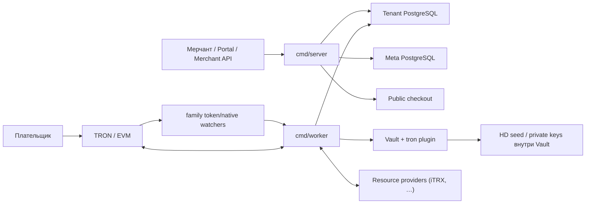

# Криптовалютный контур Metapus: архитектура и бизнес-процессы

> **TL;DR:** Metapus принимает криптоплатежи через family-адаптеры (сейчас TRON и EVM), ведёт раздельный финансовый учёт, консолидирует активы и выполняет policy-controlled вывод через Vault.
>
> **Тип:** Concept
>
> **Аудитория:** Developer, Security, Finance, Admin
>
> **Связанные:** [add-blockchain-network.md](../howto/add-blockchain-network.md), [crypto-security-and-risk-review.md](crypto-security-and-risk-review.md), [crypto-environment-setup.md](crypto-environment-setup.md), [crypto-processing-test-scenarios.md](crypto-processing-test-scenarios.md)
>
>
> Реализованные семейства: TRON (Nile/Mainnet) и EVM (Sepolia, выключен до
> testnet gate). Финансовое ядро chain-agnostic. TRON Energy — optional
> external resource, не бизнес-процесс инвойса. В dev-seed основной токен —
> USDT-TRC20.

---

## Текущая схема и AML/custody

Текущий release ожидает schema **76**. Внешняя форма обычного invoice/payment сохраняется, но маршрут расходования зависит от custody/AML policy. При enforced custody source, collector и fee wallet принадлежат одному immutable owner; shared warm-pool refill выключен. Без enabled AML scope сохраняется прежний outbound, описанный ниже.

При enabled AML scope свипы и выводы используют verified inventory, batch/source revisions, отдельный operating gas и dispatch permits. Classless legacy spending закрыт. WithdrawalRequest хранит дополнительный class-specific plan/lines и частичные результаты; старое описание одного execution document не заменяет этот план. Точные гарантии и ограничения: [custody](../operations/crypto-merchant-custody.md), [AML architecture](aml-kyt-architecture.md), [AML outbound](../operations/crypto-aml-outbound.md), [метаданные схемы 76](../METADATA.md#aml-и-merchant-custody).

## 1. Назначение и границы

Срок жизни инвойса задаётся в минутах от 5 до 10080 (неделя). Если срок не
передан при создании через API, кабинет или платёжную ссылку, используется
настройка мерчанта; явно переданный срок имеет приоритет.

Настройка «1 инвойс — 1 платёж» сохраняется в инвойсе при создании. При её
включении действующие инвойсы с нулём или одним обнаруженным платежом переходят
в новый режим до ответа на сохранение настройки. Инвойсы с несколькими
платежами продолжают прежний процесс. Выключение настройки не меняет уже
переведённые инвойсы.

В этом режиме первый подходящий перевод закрепляется под блокировкой инвойса.
Пока он подтверждается, публичная страница скрывает адрес и QR, а API возвращает
`acceptsPayments: false`. После финализации полная оплата закрывает инвойс,
недостаточная сразу устанавливает `underpaid` и отправляет `invoice.underpaid`.
Аренда адреса закрывается в той же транзакции; повторная выдача зависит от
свипа и cooldown. Дополнительные переводы не образуют CryptoPayment. Пока инвойс
не завершён, они ждут во входящем журнале; при reorg до финализации выбирается
следующий ранний канонический перевод. После завершения инвойса перевод
учитывается как невыясненное поступление (CryptoCustodyReceipt) и виден в журнале
`/api/v1/crypto/unidentified-receipts`. Оператор с правом `crypto_receipt:credit`
зачисляет его мерчанту документом CryptoMerchantCredit, выше порога токена нужно
подтверждение другим сотрудником (`crypto_receipt:approve`). После финализации
оплаты по инвойсу reorg обрабатывается процессом финансового инцидента и компенсации без повторного открытия инвойса.

Криптовалютный контур Metapus решает четыре связанные задачи:

1. Принимает оплату от клиента мерчанта на управляемый адрес поддерживаемой
   TRON/EVM-сети.
2. Подтверждает платёж и отражает обязательство перед мерчантом за вычетом комиссии процессинга.
3. Консолидирует токены с pool-адресов на hot wallet посредством свипов.
4. Выполняет контролируемые выплаты мерчанту и вывод платформенной комиссии из treasury.

Система разделяет:

- бизнес-обязательство перед мерчантом;
- фактические активы на управляемых blockchain-кошельках;
- доход процессинга;
- затраты платформы на активацию адресов, Energy и network fee;
- предоплаченный баланс внешнего провайдера ресурсов.

Это принципиально разные остатки. Наличие USDT на hot wallet не означает такую же сумму доступного баланса конкретного мерчанта, а комиссия процессинга не смешивается с расходами на TRX и iTRX.

## 2. Компоненты



### Server

`cmd/server` обслуживает:

- Merchant Public API `/merchant/v1/*` с авторизацией по `X-Api-Key`;
- личный кабинет `/portal/v1/*` с JWT, ролями мерчанта, MFA и step-up для чувствительных действий;
- ERP/admin-документы и одобрения;
- публичный checkout;
- управление webhook URL/secret и тестовую доставку webhook;
- каталоги, документы и отчётность.

### Worker

`cmd/worker` запускает отдельный `CryptoProcessor` для каждого активного tenant только при `CRYPTO_PROCESSING_ENABLED=true`. Топология ролей indexer/fullnode/solidity загружается из `CRYPTO_CHAIN_CONFIG_FILE`; наличие отдельного TRON env больше не управляет запуском. Внутри работают:

- TRC-20 watcher;
- native TRX watcher;
- обработчик входящих событий;
- проверка confirmations;
- истечение инвойсов;
- оценка необходимости свипов;
- активация pool-адресов;
- исполнение свипов;
- исполнение withdrawal и treasury withdrawal;
- аренда и учёт TRON Energy;
- settlement исходящих транзакций;
- blockchain reconciliation.

Runtime discovery читает полный каталог network/token одним SQL-запросом из
tenant DB: ограничение числа строк JOIN здесь недопустимо, иначе сеть или её
набор contracts/native token могут загрузиться частично. Worker выбирает активные
сети; targeted preflight может выбрать ещё не активированную сеть. В обоих путях
учитываются только активные, не помеченные на удаление токены; конфигурация каждой
выбранной сети валидируется до построения runtime.

### Хранилища

- Meta DB хранит tenant registry и индекс хешей merchant API keys, по которому определяется tenant до подключения к его БД.
- Каждый tenant имеет отдельную PostgreSQL БД с каталогами, документами, регистрами, политиками и аудитом.
- Vault хранит HD seed и выполняет derivation/signing. Приватные ключи управляемых кошельков не должны попадать в tenant DB или логи.

### 2.1 Clean Architecture и транзакционная граница

HTTP transport ограничен операциями bind, извлечение доверенного auth context,
вызов application use case и отображение ошибки/DTO. Handler не исполняет
финансовый SQL, posting orchestration или переходы FSM. Domain определяет
агрегаты, состояния и инварианты; PostgreSQL, Gin, Vault, RPC и provider clients
являются adapters.

Финансовая команда входит в транзакцию через application-level `TxManager`.
`CommandExecutor` атомарно захватывает identity команды, выполняет business
callback и сохраняет application result envelope. Identity равна
`(scope_type, scope_id, operation, idempotency_key)`, а immutable canonical
fingerprint строится из validated business DTO, resource path и значимых query.
Одинаковый replay возвращает тот же semantic result; повтор ключа с иным
fingerprint завершается конфликтом. Незавершённая запись не переживает rollback.

RPC, Vault signing, resource provider и webhook delivery не выполняются внутри
финансовой транзакции. До внешнего вызова сохраняется immutable intent/signed
envelope; после вызова отдельная идемпотентная команда фиксирует observation,
receipt или settlement.

## 3. Модель кошельков

`cat_wallets` содержит управляемые адреса сети:

- `hot` — источник активаций и исходящих выплат, получатель свипов;
- `pool` — адреса, выдаваемые для приёма оплаты;
- `transient` — временно арендуются инвойсу;
- `persistent` — закрепляются за парой merchant/customer.

Основные состояния pool-кошелька:

- `free` — доступен для выдачи;
- `leased` — выдан transient-инвойсу;
- `assigned` — постоянный адрес клиента;
- `sweep_pending` — ожидает свип;
- `sweeping` — захвачен исполнителем;
- `frozen` — операционная блокировка.

Отдельно хранится состояние активации TRON account:

- `unknown`;
- `activating`;
- `active`;
- `held`;
- `failed`.

`chainActivationStatus` — оперативная проекция готовности адреса, а не журнал
blockchain-транзакции. TX, settlement, finality, фактическая стоимость и ошибка
финальной операции хранятся в `CryptoNetworkOperation` и техническом регистре
активаций. Учётная отмена документа не откатывает эту проекцию.

Основание документа имеет тип `CryptoAccountActivationTask` и ссылается на ID
технической activation-задачи. Это не самостоятельный вид документа и не старое
имя `CryptoNetworkOperation`.

Для выдачи инвойсу кошелёк должен одновременно быть активным, свободным, не удалённым, не иметь allocation hold, не иметь открытого reconciliation-инцидента и пройти карантин повторной выдачи (`cooldown_until IS NULL OR cooldown_until < NOW()`). Выбор выполняется транзакционно через `FOR UPDATE SKIP LOCKED`. Policy lock дополнительно требует `lease_blocked_reason=''` и отсутствие open `reg_crypto_network_holds`; watcher lag **не** пишет network hold.

Network и wallet allocation holds — независимые записи с immutable
`owner_type + owner_id`, а не scalar-причина на кошельке или одна причина на
сети. `OperationalHoldService` идемпотентно приобретает hold и разрешает снять
только holds конкретного owner workflow. Поэтому разрешение одного incident не
может открыть сеть или кошелёк, пока существует другая открытая причина.

Поле `leased_until` сейчас заполняется на 30 минут, но фактическое освобождение transient-адреса определяется завершением или истечением инвойса. Поэтому это поле нельзя интерпретировать как самостоятельный источник истины для TTL инвойса.

После `expired` / `cancelled` / финализированного платежа transient-адрес получает `cooldown_until` и строку в `reg_crypto_wallet_allocations`. Входящий transfer сначала пишется в `reg_crypto_inbound_chain_events`, затем матчится по blockchain timestamp и окну аллокации, а не только по текущему `leased_for_id`. Поздний перевод на закрытый инвойс проводит средства и шлёт `invoice.late_payment`; GET-статус инвойса не reopen. Полный контракт: [wallet-address-reuse.md](wallet-address-reuse.md).

### 3.1 Автопополнение wallet pool

Механизм не выводит поддержку сети из её `code` или одного лишь
`chain_family`. Family adapter объявляет неизменяемый
`ChainFamilyCapabilities.WalletProvisioning`:

- `unsupported` — автоматическое создание адресов недоступно;
- `derived` — полученный из Vault адрес сразу является chain-active;
- `derived_with_activation` — после derivation требуется отдельная on-chain
  materialization; сейчас этот режим использует TRON.

Admin получает тот же контракт из `ChainFamilyCapabilityRegistry` и не даёт
включить unsupported policy. Operator policy хранит только watermarks, quotas
и опциональную секцию `activation`; она обязательна лишь для
`derived_with_activation`. Repository выбирает refill candidates по
`enabled`, `needs_review` и lifecycle сети, не анализируя family/code. Worker
повторно проверяет capability реально собранного `NetworkDriver` перед
планированием и перед derivation.

Любой новый адрес сначала блокируется причиной
`chain_balance_check_pending`. После точной ledger-vs-chain reconciliation hold
снимается. В режиме `derived` адрес затем готов к allocation; в
`derived_with_activation` он сначала проходит account activation.

## 4. Приём платежа

### 4.1 Создание инвойса

Мерчант создаёт инвойс:

- через `/merchant/v1/invoices` по API key;
- через личный кабинет;
- через внутренний системный процесс.

Merchant API:

- принимает сумму в минорных единицах токена;
- требует scope `invoice:create`;
- поддерживает TTL от 5 до 10080 минут; без явного срока используется настройка мерчанта (по умолчанию 60);
- поддерживает merchant-scoped `orderId` и стандартный `Idempotency-Key`;
- возвращает opaque checkout reference вида `ci_<128-bit-hex>`;
- не требует `X-Tenant-ID`: tenant определяется по API key.

Повтор с тем же ключом и тем же payload возвращает существующий инвойс. Повтор с другим payload конфликтует. `orderId` и `Idempotency-Key` независимо уникальны в рамках мерчанта.

Для transient-сценария инвойсу арендуется свободный pool-кошелёк. Для постоянного адреса `/merchant/v1/addresses` создаёт или возвращает привязку по `merchant + network + customerId`.

Автоматические пополнения persistent-кошельков создаются с `invoice_kind='top_up'` и `creation_source='system'`. `IsPersistentTopUp` проверяет системную классификацию, принадлежность persistent-кошелька и связь с платежом. `externalId` и `orderId` остаются пустыми до привязки реквизитов мерчанта; `/reference` принимает один или оба реквизита. Хэш и идентичность chain event хранятся в `CryptoPayment`. См. [решение о владении реквизитами](invoice-reference-ownership-design.md).

### 4.2 Наблюдение blockchain

Worker опрашивает TRON:

- базовый интервал — около 3 секунд;
- при отсутствии работы интервал увеличивается до 30 секунд;
- в режиме catch-up — около 500 мс;
- TRC-20 watcher использует indexing lag 2 минуты;
- при перезапуске делает lookback 5 минут;
- checkpoint сохраняется по `network_id + watcher_key`.

TRC-20 и native TRX отслеживаются раздельно. Входящий перевод сопоставляется с управляемым адресом. Исходящий перевод с управляемого адреса:

- игнорируется как входящий платёж, если обе стороны управляются Metapus;
- либо классифицируется как известный managed transfer;
- либо сохраняется как внешний outflow для reconciliation.

Список наблюдаемых адресов атомарно обновляется каждые 5 минут, поэтому новый
управляемый кошелёк подхватывается без restart и без data race.

Network loader запускает отдельный watcher и checkpoint для каждого активного
TRC-20 contract сети, а также native TRX watcher. Contract входит в watcher key,
поэтому события разных токенов не разделяют checkpoint.

Token входящего события всегда разрешается по immutable паре
`(network, contract)`, где пустой contract означает native asset. До создания
payment processor проверяет совпадение event token с token инвойса. Поэтому TRX,
отправленный на адрес активного USDT-инвойса, не может быть ошибочно проведён
как USDT.

### 4.3 Создание платежа и финализация

Для каждого канонического входящего chain effect создаётся не более одного
`CryptoPayment`. Обработка защищена:

- уникальностью tx hash;
- транзакционной блокировкой инвойса;
- FSM платежа;
- журналом переходов `reg_crypto_payment_events`.

Платёж проходит состояния:

```text
detected -> confirming -> confirmed
                      \-> reorged -> detected
confirmed -> settled
```

Canonical/finality observation может вернуть платёж в reorg workflow. Posting
и settlement повторяемы: unique basis и movement constraints не допускают
второго economic effect после restart или повторной доставки chain event.

Мелкие входящие переводы менее 1000 минорных единиц по умолчанию считаются dust и не создают платёж. Для USDT с 6 decimals это 0,001 USDT.

Инвойс обновляется по накопленной полученной сумме:

- `created`;
- `partially_paid`;
- `paid`;
- после достаточных confirmations — `confirmed`;
- после ledger posting достаточной final-суммы — `completed`;
- после потери ранее canonical funds — `reversed`;
- при expiry с положительной недостаточной суммой — `underpaid`;
- по TTL — `expired`;
- вручную — `cancelled`.

Переплата является вычисляемым условием `creditedAmount > expectedAmount`, а не
отдельным статусом. Истечение применяется к `created` и `partially_paid` под
блокировкой агрегата. Полученный до истечения платёж остаётся в документах и
регистрах; late payment атрибутируется по immutable allocation window без reopen.

### 4.4 Комиссия и бухгалтерские движения

В момент создания `CryptoPayment` фиксируется snapshot тарифа:

```text
fee = clamp(fixed_fee + amount * percent_bp / 10000, min_fee, max_fee)
merchant_net = amount - fee
```

Проведение подтверждённого платежа создаёт:

- receipt на blockchain-баланс управляемого pool-кошелька;
- receipt дохода processing fee;
- receipt обязательства перед мерчантом на `merchant_net`.

Отсутствие применимого тарифа означает явно бесплатную операцию. Ошибка чтения
merchant/global fee repository отличается от отсутствия тарифа и обрабатывается
fail-closed: транзакция создания payment и проводок откатывается, chain event
повторяется после восстановления конфигурации. Нулевая комиссия больше не
используется как маскировка infrastructure error.

## 5. Свип pool → hot

Свип не изменяет обязательство перед мерчантом: это перемещение активов между двумя управляемыми кошельками.

### 5.1 Условия

Для token/merchant используются:

- `sweep_threshold`;
- `sweep_max_age_hours`;
- `sweep_retain_amount`.

Настройка мерчанта в `reg_merchant_token_config` переопределяет дефолт токена. Сумма к переводу:

```text
reserveRaw = sweep_retain_amount
sweepRaw = managedWalletBalanceRaw - reserveRaw
```

Расчёт выполняется в `NUMERIC(78,0)`/`CryptoAmount` поверх `big.Int` без floating-point. При
`managedWalletBalanceRaw <= reserveRaw` durable attempt и on-chain транзакция
не создаются. Reserve относится к одному `token_id`/контракту и не зависит от
TRX-баланса адреса.

`persistent` pool wallet закреплён за клиентом, `transient` после инвойса
возвращается в пул; оба адреса переиспользуются. Отдельного disposable-режима
в текущей архитектуре нет, поэтому reserve применяется к обоим. Для токена с
`sweep_retain_amount=0` сохраняется полный drain.

`threshold = 0` означает возможность свипа после каждого подтверждённого платежа. Иначе evaluator раз в минуту выбирает адреса, достигшие порога или максимального возраста.

### 5.2 Исполнение

1. SQL claim читает текущий managed wallet balance и фиксирует
   `balanceRaw - reserveRaw` в durable attempt `reg_crypto_sweep_attempts`.
2. Pool-кошелёк переводится в `sweeping`.
3. Создаётся пользовательский документ `CryptoSweep` и его строка.
4. При включённом iTRX резервируется Energy для source wallet.
5. Создаётся unsigned TRON transaction.
6. Создаётся immutable signing authorization, связанная с `CryptoSweep`.
7. Vault проверяет authorization и подписывает транзакцию.
8. Транзакция отправляется в TRON.
9. При принятом broadcast документ проводится:
   - expense pool wallet;
   - receipt hot wallet.
10. Settlement считывает receipt транзакции, фиксирует результат и фактический network fee.

Кошелёк является общим ресурсом всех его токенов. Если в одном цикле есть
свипаемые contract-токены, native-баланс сохраняется для gas: native drain в этом
же claim не создаётся. Отдельный native-only свип допустим, когда contract-токены
уже не требуют свипа и нет незавершённых token fee reservations.

`SweepLifecycleService` атомарно завершает attempts и возвращает кошелёк в пул
только при отсутствии незавершённых sibling attempts. Ошибка или expiry одной
попытки не меняет `sweeping` активного соседа. Signing TTL не отменяет попытку,
у которой уже существует signing authorization либо durable JIT funding.

JIT имеет независимый receipt poller с PostgreSQL lease: финализация продолжается
при истёкшем родителе, allocation hold, выключенной сети и недоступном signer.
RPC вызывается до транзакции; `NativeFundingSettlementService` проверяет полную
receipt/reservation identity, блокирует funding-документ и атомарно записывает
fee, оба principal movements и terminal state. Повтор — no-op; reverted receipt
проводит только фактический fee; cap violation остаётся audited hold.
В той же транзакции ставятся две durable reconciliation-заявки — для source и
destination wallet. После commit обычный reconciliation worker проверяет
ledger/chain и разрешает только принадлежащие его инцидентам holds.

Ранее истёкшая unsigned попытка не воскресает. После settlement её JIT и успешной
reconciliation maintenance закрывает оставшийся draft и планирует новую попытку
из текущего ledger balance. Holds снимает только их owner workflow. Проводки,
подписанные envelopes и история старой попытки сохраняются.

`CryptoSweep` не должен иметь `basis_type = CryptoSweepAttempt`: attempt является внутренним execution state, а signing/учёт привязаны к документу и строке.

Неопределённый результат broadcast не приводит к созданию новой транзакции. Сохранённая signed transaction используется для повторного определения результата либо операция переводится в `held`.

## 6. Вывод средств мерчанта

### 6.1 Доступ и whitelist

В portal:

- Owner добавляет или удаляет разрешённый адрес вывода;
- Manager создаёт заявку на вывод;
- оба действия требуют свежего step-up;
- адрес обязан находиться в `reg_withdrawal_addresses` для мерчанта и сети.

Сумма в portal задаётся decimal-строкой и преобразуется в минорные единицы токена.

### 6.2 Debit-first и политика одобрения

При создании `WithdrawalRequest` доступный баланс мерчанта уменьшается сразу. Это debit-first модель: повторная попытка не может потратить ту же сумму.

Одновременно формируются и замораживаются:

- Money Movement Intent;
- risk assessment;
- policy decision;
- версия и digest подписанной approval policy;
- список требуемых principals.

Политика может автоматически одобрить низкорисковую сумму либо потребовать `admin`, `risk` или оба одобрения. Admin approval привязан к конкретному `intent_digest` и требует object-bound step-up:

```text
money_movement.approve:<intent_digest>
```

Approvals хранятся как JWS и повторно проверяются worker перед подписанием.

### 6.3 Исполнение и settlement

1. Worker claim-ит approved/signing request.
2. Повторно сверяет frozen intent с текущими полями заявки.
3. Проверяет policy bundle и approvals.
4. Резервирует доступный token-баланс hot wallet.
5. Создаёт `CryptoWithdrawal` со ссылкой на `WithdrawalRequest`.
6. При необходимости получает Energy.
7. Создаёт unsigned transaction и signing authorization.
8. Vault валидирует все параметры и подписывает.
9. После принятого broadcast проводится только расход hot wallet. Баланс мерчанта второй раз не списывается.
10. Settlement переводит документы в `confirmed` либо `failed`, фиксирует chain result и фактическую комиссию TRX.

До broadcast terminal failure выполняет сторно исходного списания с мерчанта.
При подтверждённом on-chain failure settlement в одной транзакции восстанавливает
и managed-wallet ledger, и merchant balance. Детерминированные movement IDs и
row lock делают компенсацию идемпотентной и не допускают двойного возврата.

Основные статусы заявки:

```text
pending_approval -> approved -> signing -> broadcast -> confirmed
                 \-> rejected
approved/signing/broadcast -> held|failed
```

## 7. Treasury withdrawal

Treasury withdrawal предназначен для вывода накопленного дохода платформы, а не средств конкретного мерчанта.

Отдельно существуют:

- treasury allowlist;
- документ `TreasuryWithdrawal`;
- резерв processing fee balance;
- резерв hot-wallet balance;
- maker-checker: создатель не может одобрить собственный документ;
- policy/approval/Vault/resource/settlement-процесс.

Операция создаёт расход соответствующего fee register и расход hot wallet. Для production роли, лимиты и список адресов должны быть утверждены финансовой политикой.

## 8. TRON Energy и iTRX

iTRX включается только при наличии file-backed credentials. Без provider
стратегии `rental_required` и `prefer_rental` fail closed; fallback не
подразумевается. Прямой TRX fee разрешён только явной `burn_only` policy или
после классифицированного transient отказа уже настроенного provider в
`prefer_rental`, всегда внутри PostgreSQL budget.

При включённом iTRX:

- предварительно вызывается estimate energy;
- применяется safety margin;
- целевой резерв по умолчанию 65 000 Energy;
- аренда имеет период `1H`;
- одна активная аренда может совместно использоваться несколькими операциями одного source wallet;
- reservation не создаётся слишком близко к окончанию аренды; cutoff по умолчанию 120 секунд;
- `out_trade_no` детерминирован tenant+rental;
- неопределённый ответ заказа восстанавливается через provider query, а не новым заказом.

Стоимость Energy — расход платформы. Она учитывается независимо от merchant balance и network fee. Баланс предоплаты провайдера ведётся отдельным регистром с observations и incidents.

### 8.1 Сетевая криптооперация

Активация TRON account не заменяется арендой Energy. Hot wallet должен иметь TRX
для `wallet/createaccount`. После `BroadcastAccepted` или
`BroadcastAlreadyKnown` worker идемпотентно создаёт системный документ
`CryptoNetworkOperation` с операцией `wallet_activation`.

Если адрес уже активен до подписи либо broadcast отклонён до принятия сетью,
документ не создаётся. Неопределённый broadcast переводит workflow в
восстановление; новая транзакция до выяснения судьбы подписанного envelope не
формируется.

Документ имеет номер с префиксом `CNO` и закрытый тип операции. В текущей версии
разрешён только `wallet_activation`; неизвестный тип не проходит валидацию и не
генерирует движения.

| Группа | Реквизиты |
|---|---|
| Lifecycle | `operationType`, `status`, `finalizedAt`, `posted`, `postedVersion` |
| Blockchain identity | `networkId`, `targetWalletId`, зафиксированный `targetAddress`, `txHash`, `chainSettlementId` |
| Стоимость | `sourceWalletId`, `costTokenId`, `costAmount` |
| Учёт комиссии | `networkFeeReservationId` (обязателен у финального документа) |

Статусы документа:

| Статус | Смысл |
|---|---|
| `broadcast` | TX принята сетью или уже известна; финальный receipt ещё не обработан |
| `succeeded` | Receipt финансово финален и успешен |
| `reverted` | Receipt финансово финален, сеть откатила исполнение, но могла списать fee |

Уникальные индексы не допускают второй документ для одного
`(operation_type, network_id, tx_hash)` и второй документ по тому же основанию
активации. `reg_crypto_account_activations` хранит только queue/retry/lease,
budget-recovery state и `network_operation_id`; TX и учётные реквизиты там не
дублируются.

После solidified/finalized receipt единый транзакционный координатор:

1. создаёт или переиспользует `ChainSettlement` и компоненты комиссии;
2. завершает fee reservation;
3. фиксирует `costAmount`, settlement, статус и `finalizedAt` документа;
4. проводит документ через PostingEngine;
5. обновляет техническое состояние задачи.

Activation reservation нельзя завершить общим методом с прямой записью
движений: `FeeBudgetManager` отклоняет такой вызов. Единственный владелец
финализации и учёта активации — координатор `CryptoNetworkOperation`.

`wallet_activation` формирует расход native balance исходного hot wallet и
platform cost `chain_network_fee` с `purpose=activation`, `provider=chain` и
`externalOrderId=txHash`. Нулевая комиссия не создаёт движений, но успешный
финальный документ проводится. `reverted` также проводится на фактически
списанную комиссию, а проекция кошелька получает `failed`.

Перед проведением проверяются сеть target/source wallet и token, совпадение
зафиксированного `targetAddress` с целевым кошельком, нативный стандарт токена,
различие source и target wallet, непустые address/TX,
соответствие TX и settlement, финальность receipt, статус settlement и
неотрицательная сумма. Успешный документ не делает кошелёк
`active` сам по себе: после finality worker отдельно проверяет видимость account
в сети и только затем обновляет оперативную проекцию.

Документ только для чтения: создаёт и проводит его координатор активации, а
пользователь видит список, карточку, движения и связанные документы. Финальный
документ всегда связан со своим fee reservation; распроведение отклоняется,
исправление признанной комиссии возможно только отдельным компенсирующим
документом.

## 9. Vault и подпись транзакций

В Vault установлен пользовательский plugin `vault-sign-plugins/tron`.

Подписываемый `SigningAuthorization` использует `schema_version=1` и
family-specific `policy_version` формата `<chain_family>-v1`. Domain, PostgreSQL
и Vault plugin принимают только этот согласованный контракт.

Tenant config имеет версию `tron_tenant_signing_config.v3` и содержит:

- HD seed;
- authorization keyring `kid → Ed25519 public key`;
- public keys intent/risk/policy decision;
- public keys admin/risk approvals;
- tenant binding.

Sweep destinations хранятся отдельно в `tron_sweep_destinations.v1`; в allowlist
можно добавить только wallet, ранее выведенный для этого tenant и сети.

Адреса выводятся по пути:

```text
m/44'/195'/{account}'/0/{index}
```

Перед подписью plugin проверяет:

- tenant;
- JWS signing authorization;
- срок действия;
- purpose и basis;
- source address и `vault_key_id`;
- destination;
- token standard и contract;
- amount и fee limit;
- unsigned tx, txID и raw data;
- policy digest;
- approval bundle для withdrawal/treasury.

Таким образом, компрометация worker сама по себе не должна позволять подписать произвольный перевод: Vault принимает только транзакцию, совпадающую с заранее подписанным разрешением и политикой.

В локальной разработке можно явно выбрать `CRYPTO_AUTH_SIGNER=local`. Production
принимает только `CRYPTO_AUTH_SIGNER=transit`: worker формирует детерминированный
JWS input, а per-tenant Ed25519 private key никогда не покидает Vault Transit.
Worker обращается к выделенному Vault Proxy без токена; Proxy добавляет и
обновляет свой AppRole token.

## 10. Reconciliation и восстановление

Раз в 15 минут worker сравнивает:

- ledger token balance и on-chain TRC-20 balance;
- ledger native balance и on-chain TRX balance;
- известные исходящие транзакции и внешние outflow;
- provider ledger и баланс iTRX.

Результаты разделены на:

- run;
- persistent incident;
- immutable observation.

Внешнее пополнение управляемого кошелька native TRX не добавляется в ledger
вручную. Оператор запускает `crypto-record-wallet-funding`: команда получает
транзакцию из TRON RPC, проверяет успешный confirmed native transfer, сеть,
получателя и сумму, затем атомарно создаёт immutable receipt в
`reg_crypto_wallet_fundings` и физический приход hot/pool wallet. `tx_hash`
уникален, поэтому повтор команды идемпотентен.

После finality `CryptoNetworkOperation` проводится по правилам §8.1. Повторное
восстановление стоимости вызывает тот же координатор и не создаёт второй
settlement, документ или движения. Это сохраняет равенство ledger с on-chain
остатком и не смешивает операционный расход с обязательством перед мерчантом.

Каждая подписываемая операция сохраняет immutable expected chain effects:
network, ordinal/event kind, canonical source/destination, token/contract и
amount; tx hash добавляется одновременно с persisted signed envelope. Наблюдение
считается известным исходящим только после exact match всей effect identity.
Совпадение одного tx hash без совпадения transfer effect не авторизует outflow.

Observed identity равна `(network, tx_hash, event_kind, event_index)`. Повторное
наблюдение обновляет finality projection, но не создаёт второй outflow/incident;
каждый reconciliation run добавляет immutable observation. Новый unknown effect
атомарно создаёт external outflow, incident и независимые network/wallet holds.
Порядком этой команды владеет application-level `ExternalOutflowDetectionService`;
PostgreSQL adapters раздельно отвечают за exact match, outflow, run, incident,
observation и action. Повтор уже сопоставленной observed identity заново проверяет
весь payload, а конфликт amount/address/contract/token становится аномалией.

Операторский workflow append-only:

```text
pending_review -> classified -> resolved
```

`matched_basis` требует exact expected effect; `false_positive_or_reorg` —
сохранённый chain proof; `unauthorized_loss` — final confirmation-complete
custody loss. Последний вариант создаёт ровно один `CryptoCustodyAdjustment`.
Другой, fresh-step-up approver проводит adjustment через общий `posting.Engine`:
ровно один wallet expense и один platform `custody_loss`; merchant balance не
затрагивается. Deferred PostgreSQL constraint подтверждает весь набор движений,
а custody-loss movements нельзя изменить или удалить. Перед posting и resolution
финальность проверяется повторно под lock. Resolution требует успешную
reconciliation, завершённую позже posting decision, и снимает только holds этого
outflow в той же транзакции. Связанный reconciliation incident переходит в
`resolved` атомарно с outflow, поэтому terminal workflow не оставляет скрытый
open incident. Проведённый loss исправляется новым компенсирующим
документом, но никогда не unpost/delete исходного финансового факта.

Открытый balance mismatch ставит pool-кошелёк на owner-bound allocation hold.
После восстановления равенства разрешается только hold соответствующего
incident; любая другая открытая причина продолжает блокировать allocation.

`BalanceReconciliationService` через `TxManager` атомарно сохраняет check,
incident projection, immutable observation и изменение owned hold. RPC остаётся
в worker до начала этой транзакции. Wallet lock сериализует создание/разрешение
incident и проверку allocation readiness. Повтор `(run, wallet, token)` с теми же
суммами — no-op даже после resolution; другой payload этого run — conflict.
Новый run добавляет observation и увеличивает occurrence count ровно один раз.
`details`, actor и время исходного hold не обновляются: актуальные delta и run
читаются из incident/observations. Новый mismatch после resolution получает
новый incident ID и новый hold, не переоткрывая историческую запись.
Ошибка persistence делает run `failed` и не завершает durable reconciliation
request успешно; ошибки RPC не подменяются нулевым балансом и сохраняют holds.

Подписанная транзакция сохраняется до broadcast. Повтор worker после сбоя должен переиспользовать её, а не создавать новый tx. Claim/reservation/unique indexes защищают withdrawal, sweep, rental и settlement от параллельного двойного исполнения.

## 11. Webhooks

Реализованный dispatcher:

- разрешает только HTTPS;
- разрешает DNS и фиксирует адрес назначения;
- запрещает private/reserved IP;
- не следует redirects;
- требует TLS 1.2+;
- подписывает `timestamp.body` через HMAC;
- сохраняет delivery audit.

Merchant Developers UI/API позволяет создать endpoint, получить secret ровно
один раз, настроить подписки, ротировать secret и отправить тестовый webhook.
PostgreSQL хранит только Vault references. При ротации или удалении endpoint
уже созданные delivery jobs продолжают использовать snapshot URL/version;
старые secret refs попадают в durable retirement queue и удаляются из Vault
janitor-ом не ранее чем через 73 часа.

Portal UI следует той же server-side role matrix: Owner выполняет mutations и
ручную redelivery, Manager имеет read-only registry/events/deliveries, Viewer не
получает registry view. Это UX boundary; обязательная авторизация всё равно
повторяется middleware на каждом endpoint.

Lifecycle dispatch подключён к `invoice.paid`, `invoice.confirmed`,
`invoice.expired`, `withdrawal.confirmed` и `withdrawal.failed`. Событие
записывается в deduplicated outbox в той же транзакции, что и business state.
Dispatcher выполняет десять delivery attempts до 72 часов. Стабильный
`Metapus-Event-Id` используется для дедупликации, а новый
`Metapus-Delivery-Id` — для трассировки каждой попытки. Строгий ordering разных
событий не гарантируется: receiver должен дедуплицировать `event.id` и сверять
актуальный статус через API.

### 11.1 Merchant network policies

Merchant-specific CIDR policies существуют отдельно для `portal` и `api`;
API surface поддерживает per-key override. Baseline и key policy вычисляются как
intersection, а любой enforce-deny блокирует запрос. Адрес клиента берётся только
из валидированной trusted proxy chain; IPv4-mapped IPv6 нормализуется. Ошибка
policy read/audit в enforce path приводит к deny.

Owner меняет policy со fresh object-bound step-up и durable idempotency через
staged `off -> warn -> enforce`. Enforce требует активного CIDR и проверяет путь
recovery для текущего IP. Изменение повышает version, инвалидирует cache и
пишется в security audit. Отдельный system-admin recovery endpoint требует
admin MFA/CIDR, fresh step-up и причину; merchant `security_admin` не получает
эти полномочия.

## 12. Текущие ограничения и production gates

Программные release blockers закрыты и остаются обязательными regression
gates: per-tenant Transit/tokenless Vault Proxy, lifecycle webhook outbox,
failed-withdrawal compensation, fee fail-closed, token isolation, динамический
address refresh и multi-contract watcher.

Перед промышленным запуском остаются инфраструктурные и продуктовые gates:

1. Вынести Vault из `vault-test`, включить TLS/audit/HA и провести
   backup/restore, key rotation и disaster-recovery drills.
2. Настроить PostgreSQL PITR, restore drills, P1 alerting, on-call и операционный
   SLA для held/failed/reconciliation incidents.
3. Провести Nile/Sepolia finality/reorg, RPC/provider outage, timeout, restart,
   concurrency, load и chaos conformance; затем отдельно утвердить Mainnet model.
4. Проверить treasury happy path, maker-checker, лимиты hot wallet и процедуру
   proof-of-assets-and-liabilities.
5. Выполнить full-stack security-negative gate для merchant Portal/API/per-key
   CIDR, trusted proxies, cache invalidation и system-admin recovery.
6. Получить полный T01--T30 evidence bundle без `NOT_RUN/PARTIAL/BLOCKED`, включая
   финансовые snapshots, testnet chain evidence и kill-switch drill.

До закрытия отдельного Mainnet deployment gate текущий контур пригоден для
dev/staging и контролируемого Nile E2E, но не называется полностью
production-ready. Полный gate и rollout описаны в
[production-deployment.md](../operations/production-deployment.md).

## 13. Карта основных сущностей

| Область | Основные таблицы |
|---|---|
| Сети и токены | `cat_blockchain_networks`, `cat_tokens`, `reg_merchant_token_config` |
| Кошельки | `cat_wallets`, `reg_crypto_account_activations`, `doc_crypto_network_operations`, `reg_crypto_wallet_fundings`, `reg_crypto_wallet_allocation_holds` |
| Приём | `doc_crypto_invoices`, `doc_crypto_payments`, `reg_crypto_payment_events` |
| Балансы | `reg_crypto_balance_*`, `reg_crypto_merchant_balance_*`, `reg_crypto_fee_*` |
| Свип | `doc_crypto_sweeps`, `doc_crypto_sweeps__lines`, `reg_crypto_sweep_attempts` |
| Вывод | `reg_withdrawal_addresses`, `doc_withdrawal_requests`, `doc_crypto_withdrawals` |
| Treasury | `reg_treasury_withdrawal_addresses`, `doc_treasury_withdrawals` |
| Подпись | `reg_crypto_signing_authorizations`, `reg_crypto_expected_chain_effects`, `reg_crypto_chain_effect_matches`, `reg_money_movement_intents`, `reg_money_movement_approvals` |
| Ресурсы | `cat_crypto_provider_accounts`, `doc_crypto_resource_rentals`, `reg_crypto_resource_allocations` |
| Расходы | `reg_crypto_platform_cost_movements`, `reg_crypto_provider_balance_*` |
| Reconciliation | `reg_crypto_reconciliation_runs`, `reg_crypto_reconciliation_items`, `reg_crypto_reconciliation_observations`, `reg_crypto_external_outflows`, `reg_crypto_external_outflow_observations`, `reg_crypto_external_outflow_actions`, `doc_crypto_custody_adjustments`, `reg_crypto_network_holds`, `reg_crypto_wallet_allocation_holds` |
| Network access | `auth_merchant_network_policies`, `auth_merchant_allowed_networks`, `auth_merchant_network_policy_audit` |
| Watcher/webhook | `sys_chain_watcher_state`, `sys_merchant_events`, `sys_webhook_delivery_jobs`, `sys_webhook_deliveries` |

## 14. Файловая карта

```text
cmd/server/main.go                                      — сборка HTTP/API-контура
cmd/worker/main.go                                      — запуск tenant crypto processors
internal/infrastructure/crypto_worker/processor.go      — watcher и фоновые циклы
internal/application/command/                           — transactional command idempotency
internal/application/cryptoapp/external_outflow_service.go — audited outflow/custody FSM
internal/application/cryptoapp/operational_hold_service.go — owner-bound operational holds
internal/application/cryptoapp/merchant_network_policy_service.go — merchant CIDR policies
internal/domain/crypto/capabilities.go                  — compile-time family capabilities
internal/domain/crypto/chain.go                         — runtime drivers by network_id
internal/domain/crypto/wallet_pool.go                   — capability-aware pool policy
internal/domain/crypto/event_processor.go               — применение входящих blockchain events
internal/infrastructure/crypto_worker/sweep_executor.go — свипы
internal/infrastructure/crypto_worker/withdrawal_executor.go — выплаты мерчантам
internal/infrastructure/crypto_worker/treasury_executor.go   — treasury withdrawal
internal/infrastructure/storage/postgres/outbound_repo/outbound_settlement.go — результат и network fee
internal/infrastructure/crypto_worker/crypto_network_operation_coordinator.go — atomic finality активации
internal/infrastructure/crypto_worker/reconciliation.go — сверка blockchain/ledger
internal/domain/documents/crypto_network_operation/     — модель и сервис сетевой криптооперации
internal/domain/strict_document.go                       — защита системных документов
internal/infrastructure/http/cryptohttp/cryptohandlers/crypto_network_operation.go — unlock/lock API
internal/infrastructure/blockchain/tron/funding/record.go — операторская TRON-проверка внешнего funding
internal/infrastructure/crypto_worker/wallet_pool_controller.go — warm-pool controller
cmd/crypto-record-wallet-funding                     — операторская запись funding
vault-sign-plugins/tron                                 — derivation и Vault-side signing policy
db/migrations/00006_crypto_core.sql      — сети, токены, кошельки, инвойсы, платежи, watcher, allocation history и inbound inbox
db/migrations/00007_crypto_outbound.sql  — выводы, sweep, treasury, approval policy, signing, CryptoNetworkOperation и activation state
db/migrations/00008_crypto_aml.sql       — AML
db/migrations/00009_crypto_custody.sql   — custody-учёт
```

## Provider opening: авторство, approval и неизменяемый ledger

`ProviderBalanceWorkflowService` исполняет prepare/approve/reject через
application `command.Executor` и `TxManager`. HTTP только связывает DTO и
use case; generic Create/Update/Delete/Post/Unpost/repost отключены в metadata
и domain service. `CryptoProviderBalanceOperation` содержит decision FSM,
обязательные reasons и immutable decision actors/timestamps/mode/policy version.

Политика решения версии 1 применима только к `opening`: другой оператор с правом
approve/reject действует в режиме `independent`. Системный администратор
(`is_admin` либо роль `admin`) может одобрить или отклонить собственный opening
в явно аудируемом режиме `admin_self`. Одна роль `security_admin` исключения не
даёт. Treasury, merchant withdrawals, custody adjustments и incidents сохраняют
независимое подтверждение; MFA не заменяет второго человека.

- Prepare API:
  `POST /api/v1/document/crypto-provider-balance-operation/provider-balance-incidents/:incidentId/prepare-opening`
  с `{observationId, reason}`.
- Approve/reject API: `POST .../crypto-provider-balance-operation/:id/approve|reject`
  с `{version, reason}`.
- Все команды требуют `Idempotency-Key`, trusted actor/session/tenant,
  соответствующий `document:crypto_provider_balance_operation:create|approve|reject`
  и свежий step-up `crypto.provider_balance.<action>:<canonical-request-sha256>`.
  Fingerprint включает path ID, выбранное observation либо ожидаемую version и reason.
  Replay возвращает application result и `Idempotent-Replayed: true`, но не обходит MFA/RBAC.
- Read API списка provider incidents возвращает `observationId` и `observedAt`.
  После блокировки повторно проверяются последнее observation, все три суммы
  incident/observation, текущий provider ledger и соответствие account/token.
- Порядок блокировок: provider account → operation → incident. Provider movements
  и observation snapshots используют тот же account lock. PostgreSQL запрещает
  изменение acquisition/decision/evidence, DELETE и неточные/неатомарные проводки.
- При `admin_self` application-адаптер и transition trigger вызывают общую SQL
  проверку действующего пользователя, deletion mark и текущего административного
  права. Связь роли блокируется до строки пользователя, как при `RevokeRole`;
  после ожидания блокировок повторно проверяется object-bound step-up. Отзыв прав
  не отменяет историческое решение, но препятствует новому самоподтверждению.
- Terminal decision, точное движение и обязательная запись
  `crypto.provider_opening.decision` коммитятся атомарно. Аудит хранит maker,
  оператора, режим/версию политики, основание административного права, session ID,
  fingerprint команды и время проверки step-up. Изменение/удаление этой записи
  запрещено. Replay не создаёт вторую запись.
- Detail API добавляет `actionAvailability` для approve/reject. Это advisory
  application projection; POST независимо проверяет все полномочия заново.
  Metadata-driven форма показывает основание, предупреждение о `admin_self` и
  обязательную причину. Неопределённый результат блокирует смену решения/тела;
  retry сохраняет исходные DTO и `Idempotency-Key`.
- Incident после approval остаётся открытым до новой успешной provider-сверки.
  Wallet, merchant, fee и platform-cost ledgers от opening не меняются.

Схема собрана из девяти доменных миграций; текущий `ExpectedSchemaVersion` — 9. AML (`00008`) и custody (`00009`) входят в fresh schema. Старый тестовый
opening с нулевым maker нельзя «починить» подменой исторического автора: evidence
сохраняется, acceptance повторяется на чистой disposable БД для независимого
оператора и административного исключения. Действующий стенд автоматически не
пересоздаётся.
Generic manual funding/refund/adjustment fail closed до появления серверного
verified-receipt workflow; JSON-флаги клиента не считаются proof. Существующий
worker settlement rental charge/refund сохраняется. Эта backend-защита сама по
себе не является завершённым real-provider/UI acceptance T23.

## Связанные документы

- [add-blockchain-network.md](../howto/add-blockchain-network.md) — алгоритм подключения новой сети на примере Ethereum/EVM.
- [crypto-security-and-risk-review.md](crypto-security-and-risk-review.md) — security и executive review.
- [crypto-environment-setup.md](crypto-environment-setup.md) — развёртывание dev-контура с нуля.
- [crypto-processing-test-scenarios.md](crypto-processing-test-scenarios.md) — полный verification protocol.
- [production-deployment.md](../operations/production-deployment.md) — production rollout, rollback и DR.
