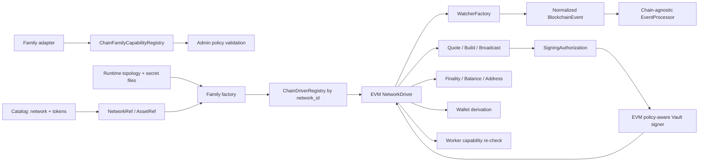

# Добавление блокчейн-сети: алгоритм на примере Ethereum

> **TL;DR:** Новая сеть существующего family подключается конфигурацией; первое подключение Ethereum требует EVM driver, Vault signer и закрытия family-specific policy gates. Сквозной precision gate уже реализован.
>
> **Тип:** How-To
>
> **Аудитория:** Developer, Security, DevOps, QA, AI-Agent
>
> **Статус примера:** EVM family и Sepolia реализованы; документ фиксирует
> extension points и обязательные gates для следующей EVM-сети.
>
> **Связанные:** [crypto-processing-architecture.md](../crypto/crypto-processing-architecture.md),
> [crypto-security-and-risk-review.md](../crypto/crypto-security-and-risk-review.md),
> [crypto-processing-test-scenarios.md](../crypto/crypto-processing-test-scenarios.md)

---

## 1. Сначала определить масштаб изменения

В Metapus `network` и `chain family` — разные понятия:

| Понятие | Ethereum-пример | За что отвечает |
|---|---|---|
| `network_id` | UUID строки `ETHEREUM-MAINNET` | Единственный runtime/FK routing key |
| `code` | `ETHEREUM-MAINNET` | Читаемый ключ каталога и deployment config |
| `chain_family` | `evm` | Выбор реализации driver и Vault signer |
| `network_identifier` | `1` | Идентификатор конкретной сети внутри EVM; для EVM это chain ID |

Отсюда есть два разных сценария.

1. **Новое окружение уже поддержанного семейства.** После появления EVM driver
   добавление Sepolia (`11155111`) или отдельного EVM L2 должно состоять из
   catalog/runtime/Vault-конфигурации и acceptance-тестов без изменения domain
   orchestration.
2. **Первое подключение семейства.** Для Ethereum этот этап закрыт отдельными
   EVM adapter, policy-aware signer и composition root.

Нельзя активировать строку `chain_family=evm`, пока worker preflight не собрал
driver, signer и все обязательные runtime capabilities. Система должна
останавливать такую сеть fail closed.

## 2. Архитектурная граница



Оркестрация в `internal/infrastructure/crypto_worker` не должна импортировать
`blockchain/evm`. Единственное место, где собираются конкретные адаптеры, —
`internal/infrastructure/blockchain/bootstrap`.

В runtime запрещено маршрутизировать операции по `code`, символу токена или
адресному префиксу. Driver выбирается только по UUID `network_id`; затем он
сверяет `chain_family` и `network_identifier`.

## 3. Обязательный pre-design для Ethereum

До написания adapter нужно зафиксировать четыре решения.

### 3.1. Точность суммы

Ethereum исполняет нативные суммы и network fee в wei, ERC-20 использует
`uint256`. Поэтому gwei не является единицей хранения: округление до gwei
необратимо теряет wei и разрушает точное сравнение ledger/chain.

Precision gate закрыт общим контрактом, обязательным для всех family:

- crypto amount — immutable value object поверх `big.Int`;
- PostgreSQL — `NUMERIC(78,0)` для raw units;
- JSON/API/JWS — каноническая десятичная строка, не JSON number;
- checked `Add/Sub/Cmp/MulDiv`, запрет дробных raw values;
- все amount, fee, reservation, approval и authorization поля используют этот контракт;
- `native_decimals=18` для ETH, без искусственной подмены на `9`.

`int64` остаётся только на внешних границах, где поле ограничено самим
протоколом (например, нативная сумма и `fee_limit` текущего TRON API). Такое
преобразование всегда выполняется через checked conversion и отказывает при
переполнении. В домене, ledger, PostgreSQL, API и JWS `int64` для криптосумм
запрещён.

### 3.2. Модель входящих нативных переводов

ERC-20 определяется по логам `Transfer`. Для ETH надо явно выбрать покрытие:

- обычные переводы из top-level transaction;
- internal value transfers из contract execution;
- выплаты через smart wallets/account abstraction.

Обычный JSON-RPC не даёт переносимый индекс всех internal transfers. Если они
поддерживаются продуктом, нужен trace-capable provider/indexer и отдельный
stable event index. Неподдерживаемые типы переводов должны быть явно описаны в
Merchant API, а не молча теряться.

### 3.3. Finality и reorg

Нужно зафиксировать, когда платёж становится финансово окончательным:

- provisional observation хранит `block_number`, `block_hash`, `tx_hash`,
  `log_index`;
- смена block hash до finality порождает `EventTypeReorg`;
- posting разрешён только после configured confirmations либо подтверждённого
  `finalized` head;
- `confirmations_needed` берётся из каталога и передаётся через `NetworkRef`,
  а не зашивается в watcher.

### 3.4. Nonce ownership

Параллельные withdrawal и sweep с одного EVM wallet не могут независимо читать
`eth_getTransactionCount(..., "pending")`. Нужен durable nonce manager:

- PostgreSQL row lock/lease на `(network_id, wallet_id)`;
- уникальность `(network_id, source_address, nonce)`;
- nonce входит в persisted unsigned envelope и signing authorization;
- restart переиспользует тот же signed envelope;
- replacement transaction допускается только отдельной policy с повышением fee.

## 4. Пошаговая реализация EVM family

### Шаг 1. Добавить adapter package

Рекомендуемая структура:

```text
internal/infrastructure/blockchain/evm/
├── driver.go          — реализация crypto.NetworkDriver
├── factory.go         — family factory для bootstrap
├── rpc_pool.go        — provider failover, circuit breaker, chain-ID probe
├── watcher.go         — native/ERC-20 discovery и durable checkpoint
├── transaction.go     — EIP-1559 quote/build/envelope
├── receipt.go         — receipt, finality, actual fee
├── balance.go         — ETH/ERC-20 balance readers
└── address.go         — normalize/validate EVM address
```

Driver реализует уже существующие узкие capabilities:

```go
type NetworkDriver interface {
    Network() NetworkRef
    Capabilities() ChainFamilyCapabilities
    Watchers() WatcherFactory
    Transactions() TransactionBuilder
    Broadcaster() Broadcaster
    Finality() FinalityReader
    Balances() BalanceReader
    Wallets() WalletDeriver
    Accounts() AccountLifecycle
    TokenAccounts() TokenAccountLifecycle
    Addresses() AddressCodec
}
```

Неизменяемые свойства рельса объявляются в `ChainFamilyCapabilities`:

| Поле | TRON | EVM | TON/Solana (ожидание) |
|---|---|---|---|
| SequenceModel | none | account | account / blockhash |
| CheckpointTimeUnit | unix_millis | unix_seconds | family-specific |
| TokenAccountModel | same_address | same_address | derived_per_asset (jetton/ATA) |
| ExternalResourceMode | optional | none | none unless a real rental provider exists |
| SupportsReplacement | false | true | only if the adapter implements fee-bump |

Для Ethereum `Accounts()` и `TokenAccounts()` возвращают `nil`. Factory и driver обязаны вернуть один контракт:

```go
ChainFamilyCapabilities{
    Family:               ChainFamilyEVM,
    WalletProvisioning:   WalletProvisioningDerived,
    RequiredRPCRoles:     []string{"rpc"},
    ExternalResourceMode: ExternalResourceNone,
    SequenceModel:        SequenceAccount,
    CheckpointTimeUnit:   CheckpointUnixSeconds,
    TokenAccountModel:    TokenAccountSameAddress,
    SupportsReplacement:  true,
}
```

Для TRON используется `WalletProvisioningDerivedWithActivation`, а для family
без автоматической генерации — `WalletProvisioningUnsupported`. Общий worker
проверяет capability перед планированием и повторно перед исполнением задания;
`chain_family`, `code` и префикс не являются разрешением на операцию.

Каждый RPC endpoint при старте проверяется через `eth_chainId`. Ответ обязан
совпасть с `NetworkRef.NetworkIdentifier`; несовпадение — terminal
misconfiguration, а не повод переключиться и продолжить работу.

### Шаг 2. Реализовать входящие события

ERC-20 watcher:

1. Запрашивает только allowlisted contract addresses активных `AssetRef`.
2. Фильтрует topic `Transfer(address,address,uint256)` и monitored addresses.
3. Декодирует `uint256` без `float64`.
4. Эмитирует ключ `(network_id, tx_hash, event_kind, log_index)`.
5. Сохраняет checkpoint только после успешной обработки диапазона блоков.
6. При restart повторно сканирует bounded overlap; unique index обеспечивает
   идемпотентность.

Native watcher использует согласованный в §3.2 источник данных. Оба watcher
эмитируют только chain-neutral DTO:

```go
BlockchainEvent{
    NetworkID:     ethereumNetworkID,
    TxHash:        txHash,
    EventIndex:    logIndex,
    FromAddress:   normalizedFrom,
    ToAddress:     normalizedTo,
    TokenContract: normalizedContract, // empty for ETH
    Amount:        rawAmount,
    BlockNumber:   height,
    BlockHash:     blockHash,
    Finality:      FinalityProvisional,
    RequiredConfs: network.RequiredConfirmations,
}
```

Строкового поля `Network` в событии нет: оно было legacy-дублем и позволяло
Nile-событию ошибочно называться `tron_mainnet`.

### Шаг 3. Реализовать outbound transaction pipeline

Для ETH и ERC-20 используется EIP-1559 typed transaction. Pipeline:

1. `QuoteFee` получает `baseFee`, priority fee и gas estimate.
2. `MaxFee` вычисляется целочисленно и ограничивается network policy.
3. `Build` резервирует nonce и создаёт canonical unsigned envelope.
4. `CanonicalUnsignedFingerprint` связывает payload с family/schema version.
5. До подписи persist-ятся intent, fee reservation, nonce и authorization.
6. Vault независимо декодирует typed transaction и сравнивает chain ID, nonce,
   source, destination, value/calldata, gas limit и fee caps с authorization.
7. `Broadcast` классифицирует accepted, already-known, rejected и ambiguous.
8. При ambiguous результате worker сначала ищет сохранённый tx hash и повторяет
   byte-identical signed envelope; новая подпись запрещена.
9. Settlement ждёт finality, вычисляет `gasUsed * effectiveGasPrice` и создаёт
   network-fee posting ровно один раз.

Для ERC-20 destination авторизации — адрес получателя, а on-chain `to` — адрес
контракта. Vault plugin обязан декодировать calldata `transfer(address,uint256)`
и сверить оба значения; blind calldata signing недопустим.

### Шаг 4. Реализовать EVM Vault signer

TRON plugin нельзя расширять условными ветками EVM. Нужен отдельный
policy-aware mount/package с тем же control-plane контрактом:

- HD derivation по утверждённому EVM path;
- tenant-scoped key material;
- `Family() == evm`;
- проверка SigningAuthorization JWS и approval bundle;
- декодирование EIP-1559 transaction до подписи;
- allowlist sweep/treasury destinations;
- возврат `SignedTxEnvelope` с тем же fingerprint;
- отсутствие generic `sign(hash)` endpoint.

Worker регистрирует signer в `FamilySignerRegistry`, а wallet derivation должен
маршрутизироваться по `NetworkRef.Family`.

### Шаг 5. Подключить family в composition root

EVM factory регистрируется в
`internal/infrastructure/blockchain/bootstrap`; `crypto_worker` остаётся без
импорта EVM package. Factory получает:

- `NetworkRef` из tenant catalog;
- endpoint topology из `CRYPTO_CHAIN_CONFIG_FILE`;
- network execution policy из PostgreSQL;
- watcher state repository;
- family wallet deriver.

После сборки `ChainDriverRegistry` проверяет, что созданный driver вернул тот же
`network_id`, family, network identifier и те же capabilities, что factory.
Эта же factory добавляется в `ChainFamilyCapabilityRegistry`: Admin API может
валидировать operator policy без RPC и secrets, а worker использует
runtime-driver как вторую fail-closed проверку.

### Шаг 6. Сделать runtime policy capability-aware

Wallet provisioning уже разделён на три независимых слоя:

1. adapter capability (`unsupported`, `derived`,
   `derived_with_activation`) — неизменяемое свойство кода;
2. operator policy (`enabled`, watermarks, limits и опциональная
   `activation`-секция) — данные tenant DB;
3. runtime readiness — реально собранный driver, RPC и signer.

Repository выбирает кандидатов только по policy/lifecycle и не знает ни family,
ни сетевых кодов. Admin не позволяет включить unsupported family. Worker
повторно проверяет driver capability до создания job и до derivation. Для
`derived` новый адрес сразу получает chain-статус `active`; для
`derived_with_activation` — `unknown` и проходит отдельный activation pipeline.
Оба режима сначала проходят точную balance reconciliation и снимают
`chain_balance_check_pending` только при отсутствии расхождения.

Реализованная readiness-модель:

```text
family adapter declares:
  required RPC roles
  account activation: yes/no
  external resource rental: supported/required/none
  fee payer model
  signer + derivation provider
```

Readiness проверяет объявленные driver capabilities. Общая policy хранит fee
cap, fee funding, retry/circuit и бюджеты; TRON Energy находится в отдельной
resource policy и **отдельном** registry вендоров аренды, не в `NetworkDriver`.
См. [add-resource-provider.md](add-resource-provider.md). EVM требует только роль
`rpc`, JIT fee wallet для активных ERC-20 и не допускает resource provider.

### Шаг 7. Добавить catalog data

После закрытия P0/P1 gates создаются:

```text
BlockchainNetwork
  code                  = ETHEREUM-SEPOLIA
  chain_family          = evm
  network_identifier    = 11155111
  native_token_symbol   = ETH
  native_decimals       = 18
  confirmations_needed  = 12
  finality_mode          = confirmations_or_finalized
  block_time_seconds    = 12
  is_active             = false

Token
  code             = ETH-SEPOLIA
  network_id       = <Ethereum UUID>
  token_standard   = native
  contract_address = ""
  decimal_places   = 18
  is_active         = true

Token
  code             = PYUSD-SEPOLIA
  network_id       = <Ethereum UUID>
  token_standard   = ERC-20
  contract_address = 0xCaC524BcA292aaade2DF8A05cC58F0a65B1B3bB9
  decimal_places   = 6
  is_active         = true
```

Строка `sys_crypto_wallet_pool_policies` создаётся общей migration выключенной
и без activation-полей. После регистрации EVM adapter Admin сохраняет обычные
watermarks с `activation=null`. Нельзя заполнять activation-поля нулями:
`NULL` здесь означает отсутствие самой capability, а не нулевой бюджет.

Сеть создаётся выключенной. Contract address, decimals и chain ID должны быть
подтверждены независимым источником/двумя операторами; символ токена не является
идентификатором актива.

### Шаг 8. Настроить topology и secrets

Для каждой обязательной роли нужно минимум два независимых provider, если это
production. API keys передаются только ссылками на secret files. URL и ключи не
хранятся в tenant DB и не публикуются в runtime status.

При старте preflight проверяет:

- config содержит catalog `code`;
- endpoint отвечает ожидаемым chain ID;
- finality/read/write capabilities доступны;
- Vault EVM mount и tenant config готовы;
- все активные токены имеют допустимый стандарт/contract/decimals;
- network policy выключена либо полностью готова.

### Шаг 9. Проверить контракт тестами

Минимальная матрица:

| Уровень | Обязательные проверки |
|---|---|
| Domain | registry routing только по `network_id`; amount overflow; fingerprint family binding |
| Address | malformed, zero address, mixed-case checksum policy, normalization |
| Watcher | ERC-20 log index, duplicate replay, bounded overlap, reorg, wrong contract |
| Native watcher | каждый заявленный вид ETH transfer и явно неподдерживаемые случаи |
| RPC pool | wrong chain ID, primary timeout, rate limit, lagging finality provider |
| Transaction | EIP-1559 serialization, nonce collision, fee cap, ERC-20 calldata |
| Vault | cross-tenant/network replay, changed nonce/value/calldata/fee, expired authorization |
| Integration | payment → confirmations → posting → sweep → withdrawal → reconciliation |
| Crash | до/после nonce reserve, authorization, signing, broadcast и settlement |
| Finance | exact raw-unit reconciliation и единственный network-fee posting |

В `crypto_worker/architecture_test.go` сохраняется запрет на прямой импорт
family adapter из общей orchestration.

### Шаг 10. Выполнить rollout

Рекомендуемый порядок:

1. Local dev chain или Anvil с детерминированными reorg/fee/nonce тестами.
2. Sepolia в watcher-only режиме: наблюдение включено, обработка операций выключена.
3. Sepolia outbound с малыми лимитами и отдельным Vault tenant config.
4. Полная reconciliation и crash matrix.
5. Mainnet watcher-only/canary.
6. Явное enable через Admin policy с MFA и audit event.
7. Постепенное увеличение per-tx/daily limits.

Rollback выключает новые intents и watcher allocation, но не удаляет
подписанные/отправленные attempts. Broadcast/ambiguous операции продолжают
reconciliation до terminal состояния, поэтому rollback выключает обработку
операций, а не наблюдение. Наблюдение останавливается отдельно и только когда
сети ничего не нужно читать; режимы описаны в
[rpc-ingestion.md](../operations/rpc-ingestion.md#наблюдение-и-обработка-сети).

## 5. Добавление второй EVM-сети после реализации family

Когда EVM family полностью реализована, например Sepolia добавляется без новой
бизнес-логики:

1. Новая catalog network с `chain_family=evm`,
   `network_identifier=11155111`, `is_active=false`.
2. Native token и allowlisted ERC-20 tokens этой сети.
3. Отдельные endpoint pools и secret files.
4. Vault network policy/derivation scope.
5. Test wallets и network-specific fee/finality limits.
6. Preflight и acceptance matrix.
7. Admin enable.

Изменение `EventProcessor`, posting engine, invoice, sweep или withdrawal FSM в
этом сценарии означает утечку chain-specific логики и требует архитектурного
ревью.

## 6. Definition of Done

Сеть считается поддержанной, только если одновременно выполнено следующее:

- driver и signer проходят readiness и identity probe;
- суммы сохраняются и сверяются без потери raw units;
- входящие события идемпотентны по
  `(network_id, tx_hash, event_kind, event_index)`;
- reorg до finality не создаёт окончательных проводок;
- nonce/fee/signing/broadcast устойчивы к restart и конкуренции;
- секреты находятся в Vault/secret files и не попадают в логи/БД;
- все денежные движения имеют симметричные posting и reconciliation evidence;
- сеть сначала проходит testnet gate и включается отдельным audited действием;
- общая orchestration не содержит `if family == evm` для бизнес-процессов;
- wallet provisioning разрешается adapter capability, а не совпадением
  `code`, его префикса или одной лишь `chain_family`;
- `ChainFamilyCapabilities` объявляют SequenceModel, CheckpointTimeUnit,
  TokenAccountModel, MinWatcherLagSeconds, SupportsReplacement и
  ExternalResourceMode;
- семьи с `TokenAccountModel=derived_per_asset` реализуют `TokenAccounts()`,
  а не ветки в sweep/withdrawal;
- worker не импортирует `blockchain/{tron,evm,ton,solana}`;
- новый driver проходит `internal/infrastructure/blockchain/conformance`.

## 7. Оставшиеся verification gates

1. **P0 — Sepolia E2E.** Закрыть invoice, finality, JIT, sweep, withdrawal,
   treasury, Vault rejection и RPC failover на публичной Sepolia.
2. **P1 — Anvil crash/reorg matrix.** Автоматизировать deterministic reorg,
   delayed mining, fee spike и restart после reserve/sign/broadcast.
3. **P1 — live PostgreSQL integration.** Выполнить concurrency suites для
   nonce leases, replacement race и fee budget на disposable database.
4. **P1 — conformance.** `internal/infrastructure/blockchain/conformance`
   проверяет, что factory capabilities полные и согласованы. Живой RPC и
   Sepolia E2E остаются отдельным gate.

Текущий контракт не содержит прежнего code-prefix gate: имя
`TRON-NILE`/`TRON-MAINNET` не даёт capability и не участвует в refill query.
Поддержка provisioning объявляется factory/driver через
`ChainFamilyCapabilities`, Admin валидирует policy по registry, а worker
проверяет фактически собранный driver. Строковый routing field
`BlockchainEvent.Network` и hardcoded `tron_mainnet` в watcher также удалены;
порог подтверждений поступает из каталога через
`NetworkRef.RequiredConfirmations`.

## 8. Файловая карта

```text
internal/domain/crypto/capabilities.go                  — compile-time family capability registry (sequence, lag, token accounts, resources)
internal/infrastructure/blockchain/conformance          — contract tests for installed family factories
internal/domain/crypto/chain.go                         — runtime driver contract и registry by network_id
internal/domain/crypto/wallet_pool.go                   — capability-aware provisioning policy
internal/domain/crypto/blockchain_event.go              — normalized inbound event
internal/infrastructure/blockchain/bootstrap/builder.go — composition root family adapters
internal/infrastructure/blockchain/chainconfig           — endpoint topology и secret-file loading
internal/infrastructure/blockchain/tron                  — reference implementation family driver
internal/infrastructure/crypto_worker/processor.go       — chain-neutral orchestration
internal/domain/crypto/signing_authorization.go          — signing authorization contract
internal/domain/crypto/transaction_signer.go             — family signer contract и registry
internal/infrastructure/crypto/custody                    — family-keyed custody composition
internal/infrastructure/crypto/evm_vault_signer           — EVM custody client
internal/infrastructure/crypto/vault_signer              — текущая TRON custody implementation
vault-sign-plugins/evm                                   — отдельный EVM policy-aware plugin
vault-sign-plugins/tron                                  — reference policy-aware Vault plugin
db/migrations/00006_crypto_core.sql            — Sepolia catalog, nonce, finality и policy schema
```

## 9. Чеклист

- [x] Raw-unit precision зафиксирован общим `RawAmount`/`NUMERIC(78,0)`/string-контрактом.
- [x] Зафиксированы native transfer scope, finality и nonce model.
- [x] EVM factory/driver объявляют `WalletProvisioningDerived`.
- [x] Реализован отдельный policy-aware Vault signer семейства.
- [x] Runtime roles и execution policy описаны capabilities, а не TRON defaults.
- [x] Catalog network и токены созданы выключенными.
- [x] Endpoint identity probe сверяет фактический chain ID.
- [ ] Conformance, reorg, crash, security и reconciliation tests пройдены.
- [ ] Testnet gate закрыт до mainnet enable.
- [x] Mainnet исключён из v1 и не добавлен в catalog/Vault allowlist.

## Связанные документы

- [crypto-processing-architecture.md](../crypto/crypto-processing-architecture.md) — фактический TRON-контур и общие финансовые процессы.
- [crypto-security-and-risk-review.md](../crypto/crypto-security-and-risk-review.md) — security gates и threat model.
- [crypto-processing-test-scenarios.md](../crypto/crypto-processing-test-scenarios.md) — общий verification protocol.
- [vault-evm-sepolia.md](../operations/vault-evm-sepolia.md) — EVM custody и rollout runbook.
